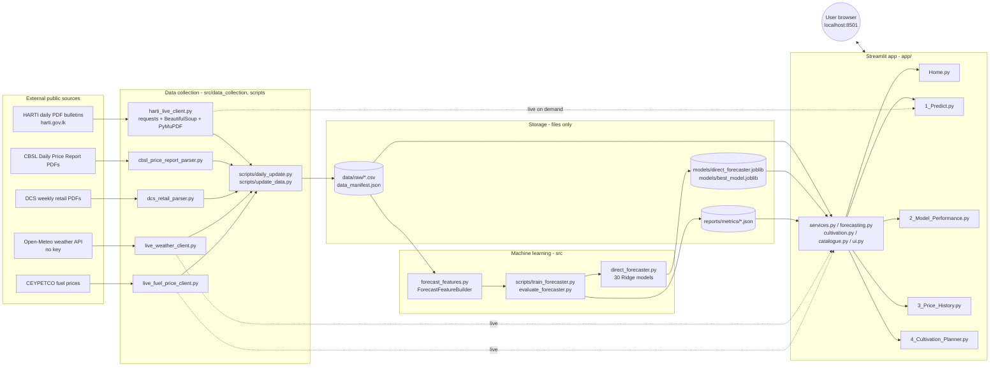
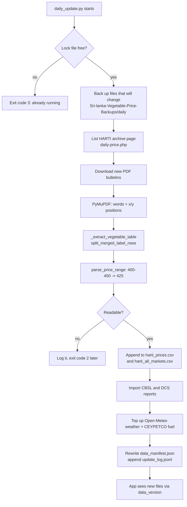
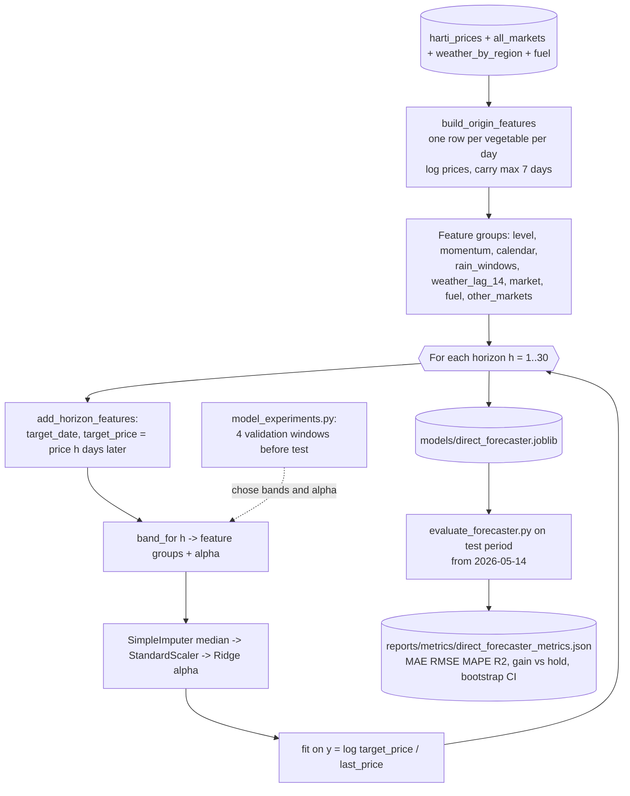
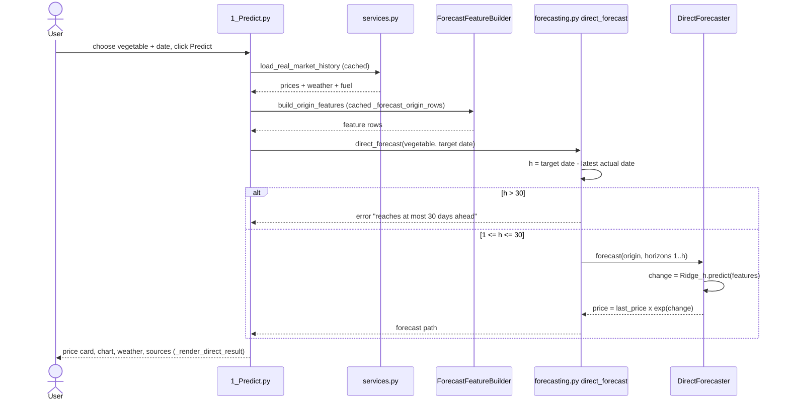
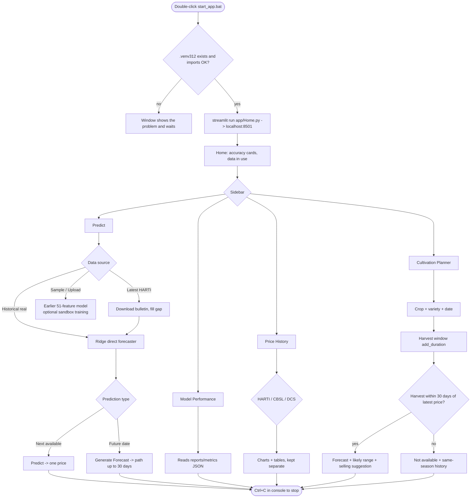

# 08 — System Architecture and Data Flow

The system is a **single-machine, layered Python application**: data-collection scripts → CSV files → feature
builder → saved models → Streamlit pages. There is no separate backend server and no database.

> සිංහල: පද්ධතිය ස්ථර (layers) 4කින් සමන්විතයි: (1) දත්ත එකතු කිරීම, (2) CSV ගොනු ලෙස ගබඩා කිරීම,
> (3) ML ආකෘතිය, (4) Streamlit අතුරුමුහුණත. සියල්ල එකම පරිගණකයේ ක්‍රියා කරයි.

## 1. Overall architecture

## 2. Data collection and preprocessing

Preprocessing for the earlier models (`src/preprocessing/pipeline.py` `run`, line 133):
load → `cleaner` (duplicates, invalid prices/weather, missing fields) → `transformer` (names, types, sort) →
`merger` (join weather and fuel by date) → `data/processed/processed_prices.csv`.

## 3. Machine learning training

## 4. Prediction workflow (Predict page, real data)

## 5. User interaction workflow

## 6. Key design decisions (be ready to justify)

| Decision | Reason |
|---|---|
| Files, not a database | One user, read-mostly, ~600k rows fit in memory; CSV is transparent and easy to back up |
| Direct (one model per horizon) instead of recursive | Recursive errors compound: MAPE 36.5 % vs 25.8 % at 15–30 days |
| Log-change target | Same model for cheap and expensive vegetables; prediction can never be negative |
| Fixed test start date | Results stay comparable as new data arrives; no peeking |
| Separate HARTI / CBSL / DCS | Different price types (wholesale/retail) and collectors — mixing would be wrong |
| Caches keyed on file modification times | App stays fast but never shows stale data after an update |
| Sandbox models saved to `models/demo` | A demo retrain can never overwrite the real model (`config.yaml` `demo_models_dir`) |
