# AI-Powered Sri Lankan Vegetable Cultivation Planning and Market Price Prediction System

CS6P05ES Project, Final Report. Kaveesha Deshan (E - 290292). Date: [Submission date].

## Abstract

Vegetable prices in Sri Lanka change quickly, and the official price information published by the Hector Kobbekaduwa Agrarian Research and Training Institute (HARTI), the Central Bank of Sri Lanka (CBSL) and the Department of Census and Statistics (DCS) describes past prices only, in PDF bulletins that are hard to analyse. This project developed a web application that turns these bulletins into validated datasets, forecasts wholesale vegetable prices at the Dambulla Dedicated Economic Centre for 1 to 30 days ahead, and links the forecasts to cultivation planning.

A parser was built for HARTI's daily bulletin archive from June 2015, producing 76,954 Dambulla and 528,587 all-market price readings by 17 November 2026; independent checks of the 2024-2026 data against the original PDFs found no extraction errors. The datasets are kept current by an automatic update every three hours, with validation, duplicate prevention, backups, retries and recovery from interrupted runs, and every page shows how fresh each source is. The forecaster is a direct multi-horizon model with one Ridge Regression per day ahead, using only information published by the forecast date, including prices reported for other markets, regional weather and fuel prices. On a held-out test period from May to November 2026 its next-day mean absolute error was Rs 17.47 per kilogram (7.5%), 4.3% lower than holding the last price, and 7.8% lower at 22 to 30 days. Earlier Linear Regression, Random Forest and XGBoost models did not beat this baseline despite R² values of about 0.96, and a retraining candidate on the full history was rejected because it did not beat the baseline at long horizons.

The Streamlit application has five pages: a home dashboard, prediction, model performance, price history and a cultivation planner that converts published Department of Agriculture harvest durations into harvest windows and compares the current price with the expected harvest-time price. The whole interface is available in English, Sinhala and Tamil. All 1,320 automated tests and 30 browser tests passed.

**Keywords:** vegetable price forecasting, Sri Lanka, Ridge regression, direct multi-step forecasting, cultivation planning, Streamlit, multilingual interface

## Acknowledgement

[Write your own acknowledgement here, for example thanking your supervisor, [First Supervisor's Name], and second marker, [Second Supervisor's Name], for their guidance, and your family and friends for their support.]

I also acknowledge the Hector Kobbekaduwa Agrarian Research and Training Institute, the Central Bank of Sri Lanka, the Department of Census and Statistics and the Department of Agriculture for publishing the price bulletins and crop information on which this project is built, and the Open-Meteo project for free historical weather data.

## 1. Introduction

### 1.1 Background

Vegetables are a daily purchase for most Sri Lankan households and an important source of income for small farmers in the central hills and the dry zone. Their prices move quickly. Vegetables are perishable, they are grown in a few concentrated districts, and a spell of heavy rain or a transport problem can change the wholesale price within days (Ezekiel, 1938). The Central Bank of Sri Lanka's Daily Price Report regularly explains such movements; for example, it attributed rising carrot prices in early November 2026 to limited supply from the Nuwara Eliya area (CBSL, 2026).

Three public organisations publish vegetable prices. The Hector Kobbekaduwa Agrarian Research and Training Institute (HARTI) publishes a daily food commodity bulletin with wholesale prices for about ten markets, including the Dambulla Dedicated Economic Centre (HARTI, 2026). The Central Bank of Sri Lanka (CBSL) publishes a Daily Price Report on working days, and the Department of Census and Statistics (DCS) publishes weekly retail prices for the Colombo District (DCS, 2026). The Department of Agriculture (DOA), through its Horticultural Crops Research and Development Institute (HORDI), publishes crop guidance that includes the time from planting to harvest (DOA, 2026).

These publications describe past prices only, and they are released as PDF documents. A farmer deciding what to plant, or a trader planning purchases, has to read the bulletins one by one and judge the future price without help. This project builds a system that turns the official records into clean datasets, forecasts the Dambulla wholesale price up to 30 days ahead, and links the forecasts to published harvest durations so that a grower can see the likely price around harvest time.

### 1.2 Problem Statement

Price information for Sri Lankan vegetables exists, but it is hard to use for planning:

- **The data is locked in PDF bulletins.** HARTI, CBSL and DCS provide no API or downloadable table, and the HARTI bulletin layout has changed several times since 2015.
- **The information looks backwards.** Bulletins report recent prices; none forecasts future prices.
- **Forecast accuracy is easy to overstate.** Daily vegetable prices usually change little from one day to the next, so a model can show a high R² while doing no better than assuming that tomorrow's price equals today's.
- **Planting and price information are separate.** Harvest durations are published by the DOA, while prices come from HARTI and CBSL. Nothing connects a planting date to the likely price at harvest.
- **Language.** The official price bulletins and most tools are in English, while many farmers read Sinhala or Tamil more comfortably.

The problem addressed is therefore to build a system that keeps official price records up to date automatically, forecasts wholesale prices with accuracy measured honestly against a simple baseline, links forecasts to cultivation timing, and presents everything clearly in English, Sinhala and Tamil.

### 1.3 Motivation

The motivation is practical and technical. Practically, Dambulla is one of the country's main wholesale vegetable markets and is reported by both HARTI and CBSL, so a forecast for Dambulla is directly useful to people who sell or buy there. Technically, vegetable prices are a demanding forecasting problem: the series are noisy and have gaps, markets influence each other, and weather affects supply with a delay. The interim study (Deshan, 2026) found that a naive persistence forecast is a strong benchmark for such data, so a central motivation was to find out whether a trained model could genuinely improve on it.

### 1.4 Aim

The aim of the project was to design, implement and evaluate a data-driven web application that forecasts Sri Lankan vegetable wholesale prices from official data, measures its accuracy honestly against a naive baseline, and supports cultivation planning by linking published harvest durations to expected prices, in English, Sinhala and Tamil.

### 1.5 Objectives

1. Collect historical vegetable prices from official Sri Lankan sources (HARTI, CBSL and DCS) and convert them into validated, machine-readable datasets with recorded provenance.
2. Combine the prices with daily weather for the main production regions (Open-Meteo) and national fuel prices (CEYPETCO).
3. Engineer features that use only information available on the forecast date, so that no future information leaks into training or evaluation.
4. Train and compare machine learning models for forecasting 1 to 30 days ahead, and evaluate them against a "hold the last price" baseline using MAE, RMSE, MAPE and R².
5. Develop a Streamlit dashboard with pages for the data overview, prediction, model performance, price history and cultivation planning.
6. Provide a cultivation planner that converts a planting date into an expected harvest window, using published DOA/HORDI durations, and compares the current price with the expected harvest-time price.
7. Keep the datasets current automatically, with validation, duplicate prevention, recovery from interruptions and visible data freshness.
8. Provide the complete interface in English, Sinhala and Tamil.
9. Test the system with automated tests and browser-based tests of the running application.

### 1.6 Project Scope

Table 1.1 summarises what the project covers and what it deliberately leaves out.

**Table 1.1: Project scope**

| In scope | Out of scope |
|---|---|
| HARTI daily wholesale bulletins from 22 June 2015, 11 markets; forecasts for Dambulla | Forecasts for other markets (they are model inputs only) |
| CBSL daily and DCS weekly prices as separate reference datasets | Using CBSL or DCS prices to train the model |
| 35 HARTI Dambulla series; forecasts for the 31 the model was trained on | Real-time prices (no public real-time source exists) |
| Forecasts 1 to 30 days after the latest published price | Cultivation cost, yield, revenue or profit estimates |
| Harvest windows from 77 published DOA/HORDI crop and variety timings | Predicting harvest dates with a model (no planting/harvest records exist) |
| Interface in English, Sinhala and Tamil | Online deployment, user accounts and access control |
| Automatic updates on a Windows PC every 3 hours | Mobile application |

### 1.7 Project Significance

The project shows that a useful forecasting tool can be built entirely from public Sri Lankan sources. Its significance lies less in the algorithm than in the complete, tested chain: reading eleven years of official bulletins correctly, keeping them current, evaluating forecasts against the obvious alternative, and presenting forecasts with their source, age and measured error. The cultivation planner and the Sinhala and Tamil interface make the results accessible to people who are not data analysts.

### 1.8 Report Structure

Chapter 2 reviews the Sri Lankan market context, existing price information systems and related forecasting research. Chapter 3 sets out the requirements. Chapter 4 presents the system design with architecture, data flow and workflow diagrams. Chapter 5 describes the implementation of each component and page. Chapter 6 reports the testing and the model evaluation, and Chapter 7 reviews the objectives, limitations and future work.

## 2. Literature Review

### 2.1 Sri Lankan Vegetable Market Context

Sri Lankan vegetables are commonly divided into up-country vegetables, such as carrot, leeks, cabbage and beetroot, grown in the cool hills around Nuwara Eliya, Welimada and Bandarawela, and low-country vegetables, such as pumpkin, brinjal, okra and gourds, grown in warmer areas. The HARTI bulletin uses this grouping in its tables. Produce moves from farms to dedicated economic centres such as Dambulla, Keppetipola, Meegoda and Thambuththegama, and to the wholesale market at Peliyagoda (which replaced Pettah in the bulletins from 2021), before reaching retailers (HARTI, 2026).

Agricultural prices respond to supply with a delay. Ezekiel's cobweb theorem (Ezekiel, 1938) described how a lag between planting decisions and harvests can produce cycles of high and low prices. Because vegetables cannot be stored for long, a temporary surplus or shortage passes almost directly into the market price. The project's own data shows this clearly: prices rose sharply from 2022, during Sri Lanka's economic crisis, and short spikes in which prices double and fall again within weeks are common (Figure 5.2 in Chapter 5).

### 2.2 Existing Vegetable Price Information Systems

The available systems report prices but do not forecast them (Table 2.1). During this project no official API, CSV or spreadsheet download was found for daily Sri Lankan vegetable prices (checked on 9 November 2026). The World Food Programme publishes a monthly Sri Lanka food price dataset on the Humanitarian Data Exchange, but it ended in September 2025 (WFP, 2026).

**Table 2.1: Existing sources of vegetable price information**

| System | What it provides | Limitation for planning |
|---|---|---|
| HARTI daily food commodity bulletin | Minimum and maximum wholesale prices for about 10 markets, daily | PDF only; past prices only |
| HARTI dashboards and "6666" telephone service | Recent averages; spoken latest prices | No export; no forecast |
| CBSL Daily Price Report | Wholesale and retail prices for Pettah, Dambulla and Narahenpita on working days, with short explanations | PDF only; past prices only |
| DCS weekly retail prices | Weekly average retail prices, Colombo District | PDF only; weekly |
| WFP food prices (HDX) | Monthly prices, CSV | Ended September 2025 |
| DOA / HORDI crop pages | Crop guidance, including harvest durations | Not linked to prices |

### 2.3 Agricultural Decision Support Systems

Decision support systems for agriculture combine data and models to help with choices such as what and when to plant or sell. International examples show that useful systems need not rely on machine learning. The FAO's Global Information and Early Warning System monitors thousands of food price series with statistical indicators (FAO, 2026), and the AGRICAF approach combines explainable machine learning with econometric models for commodity prices, treating interpretability as a requirement for non-specialist users (Zelingher, 2024). Several Sri Lankan mobile applications offer price information, but their methods are not published, so they cannot be assessed here.

Two lessons follow for this project. First, users need to know how far to trust a number: forecasts should be accompanied by an indication of their uncertainty (Hyndman and Athanasopoulos, 2021), and a tool should say when its data is out of date. Second, planning support needs both timing and price. The DOA publishes when a crop is ready for harvest, but no reviewed system connects that timing to an expected price.

### 2.4 Machine Learning for Price Forecasting

Forecasting methods for agricultural prices fall into two broad groups. Statistical time-series methods, such as ARIMA and exponential smoothing, model a series from its own past (Box et al., 2015). Machine learning methods learn a mapping from input features, which can include weather and other markets, to the future price. A review of machine learning for agricultural commodity prices found that LSTM networks and other neural networks are the most common methods, followed by ARIMA and SARIMA, and that most studies concern major crops such as maize, rice, wheat and soybeans (Tran et al., 2023).

Three findings from the wider forecasting literature shaped this project:

- **Compare with simple benchmarks.** Makridakis, Spiliotis and Assimakopoulos (2018) compared machine learning and statistical methods on 1,045 monthly series and found the machine learning methods generally less accurate. New methods must be compared with simple benchmarks under fair conditions; for daily vegetable prices the simplest benchmark is to hold the last observed price.
- **Use a suitable multi-step strategy.** In the recursive strategy, a one-step model is applied repeatedly and its predictions are fed back as inputs, so errors can accumulate. In the direct strategy, a separate model is trained for each horizon (Ben Taieb et al., 2012).
- **Evaluate chronologically.** Ordinary random cross-validation can place future observations in the training data, so time series should be evaluated on later periods (Bergmeir and Benítez, 2012). Accuracy measures also need care: MAE, RMSE and MAPE each have weaknesses, and a percentage error can mislead for low values (Hyndman and Koehler, 2006).

The algorithms considered were Linear Regression; Ridge Regression, which adds a penalty on the size of the coefficients and is stable when features are correlated (Hoerl and Kennard, 1970; Hastie, Tibshirani and Friedman, 2009); Random Forest (Breiman, 2001); and XGBoost, a regularised gradient-boosting method widely used for tabular data (Chen and Guestrin, 2016).

### 2.5 Existing Research and Related Work

Several studies have applied machine learning to Sri Lankan vegetable prices (Table 2.2). The comparison is limited to what each paper's abstract or record states, because full texts were not available for all of them.

**Table 2.2: Related Sri Lankan studies compared with this project**

| Study | Data | Methods | Reported finding |
|---|---|---|---|
| Navaratnalingam, Kodagoda and Suriyawansa (2020) | Pettah and Dambulla trade centres | Multivariate LSTM, CNN-LSTM | CNN-LSTM best; average RMSE Rs 19.46/kg |
| Fonseka and Karunasena (2022) | Colombo retail, 3 vegetables, 2009-2018 | ARIMA, LSTM | LSTM more accurate than ARIMA |
| Ranaweera, Rathnayake and Ananda (2023) | 4 vegetables; rainfall, temperature, fuel, production | 5 ML algorithms | Tree-based models performed best |
| Weerasekara et al. (2026) | 12 vegetables, 14 market centres | XGBoost, LightGBM | Production-region weather, diesel and exchange rate as inputs |
| This project | HARTI daily bulletins 2015-2026, 11 markets | Ridge direct forecaster (30 horizons); LR, RF, XGBoost | MAE 4-8% lower than holding the last price |

A related precedent for another crop is Hathurusingha, Abdelhamid and Airehrour (2019), who modelled the domestic rice price from international prices and the exchange rate.

### 2.6 Research Gap

The review identified four gaps that this project addresses:

1. **A reusable data pipeline.** None of the reviewed studies provides a tested, automatically updated pipeline that extracts daily prices from the official HARTI bulletins across their whole archive.
2. **Honest benchmarking.** The reviewed Sri Lankan studies rarely report results alongside the naive "hold the last price" forecast, which the general literature treats as essential.
3. **Decision support.** The studies produce forecasts but do not connect them to cultivation decisions, such as the expected price when a crop planted today is ready.
4. **Accessibility.** No reviewed system presents forecasts with their source, age and measured error in Sinhala and Tamil as well as English.

### 2.7 Summary

Official Sri Lankan price information is accurate but backward-looking and locked in PDF documents. Earlier studies show that machine learning can forecast vegetable prices, mostly with LSTM and tree-based models, while the wider literature warns that forecasts must be evaluated chronologically against simple benchmarks. This project builds on these points with a complete, tested system that keeps official data current, uses direct multi-horizon forecasting, reports every result against the hold-last-price baseline, and links forecasts to cultivation planning in three languages.

## 3. Requirements Analysis

### 3.1 Stakeholder Analysis

No direct access to farmers or traders was available during the project, so their needs were inferred from the information the bulletins already provide and from the related studies. This is a limitation, and user feedback is listed as future work. Table 3.1 lists the stakeholders considered.

**Table 3.1: Stakeholders and their needs**

| Stakeholder | Main needs |
|---|---|
| Farmers | Whether prices are likely to rise or fall around harvest; easy-to-read information in their own language; honesty about uncertainty |
| Traders and buyers | Short-term forecasts for specific vegetables; recent prices across markets |
| Students and analysts | Clean historical data; transparent model evaluation |
| Data maintainer (the developer) | Reliable automatic updates; early warning when a source changes its format; safe retraining |
| Examiners and supervisors | Evidence that results are genuine and reproducible |

### 3.2 Functional Requirements

Table 3.2 lists the functional requirements and where each is implemented. All are implemented.

**Table 3.2: Functional requirements**

| ID | Requirement | Implemented in |
|---|---|---|
| FR1 | Collect HARTI daily bulletins and extract the wholesale price for every market and vegetable | src/data_collection/harti_live_client.py, scripts/build_harti_prices.py |
| FR2 | Collect CBSL daily and DCS weekly prices as separate datasets | cbsl_price_report_parser.py, dcs_retail_parser.py |
| FR3 | Collect daily weather for production regions and national fuel prices | live_weather_client.py, live_fuel_price_client.py |
| FR4 | Update all datasets automatically with validation, backups and provenance | scripts/daily_update.py, run_daily_update.bat |
| FR5 | Forecast the Dambulla wholesale price for 1 to 30 days after the latest price | src/models/direct_forecaster.py, app/forecasting.py |
| FR6 | Allow a prediction from an uploaded CSV, kept apart from official data | app/pages/1_Predict.py, app/services.py |
| FR7 | Show measured model accuracy and the comparison with the baseline | app/pages/2_Model_Performance.py |
| FR8 | Show price history for each market and source, kept separate by price type | app/pages/3_Price_History.py |
| FR9 | Convert a planting date into a harvest window from published durations | app/cultivation.py |
| FR10 | Compare the current price with the expected harvest-time price | app/cultivation.py, app/pages/4_Cultivation_Planner.py |
| FR11 | Show the source, price type and data freshness with every result | app/ui.py, app/catalogue.py |
| FR12 | Let the user check the official sources on demand | app/data_refresh.py, Home and Predict pages |
| FR13 | Offer the whole interface in English, Sinhala and Tamil | app/i18n.py, app/translations/ |
| FR14 | Retrain the forecaster only when a new model is clearly better | scripts/retrain_if_better.py |

### 3.3 Non-Functional Requirements

**Table 3.3: Non-functional requirements**

| ID | Requirement | How it is addressed |
|---|---|---|
| NFR1 | Correctness of data | Every extracted price is validated and cross-checked; stored rows are never changed by updates |
| NFR2 | No data leakage | Features use only information published by the forecast date; evaluation is chronological |
| NFR3 | Transparency | Each page shows the source, market, price type, latest data date and warnings |
| NFR4 | Reliability | Network failures, missing files and unreadable bulletins produce clear messages, retries and logs instead of crashes |
| NFR5 | Maintainability | Modular packages, settings in config/config.yaml, 1,320 automated tests |
| NFR6 | Usability and accessibility | Plain-language labels, three languages, layout that works on a phone-sized screen |
| NFR7 | Performance | Datasets and models are cached and reloaded only when their files change |
| NFR8 | Polite data collection | Downloads are spaced out; CBSL's robots.txt request of 10 seconds between requests is followed |

### 3.4 User Requirements

From the user's point of view, the system should let a person (a) see at a glance how current the data is; (b) get a price forecast for a chosen vegetable and period, together with its measured error; (c) look at past prices for a market, source and date range; (d) enter a planting date and see the expected harvest window and the expected price compared with today's; and (e) do all of this in English, Sinhala or Tamil without technical knowledge.

### 3.5 Hardware and Software Requirements

**Table 3.4: Hardware and software requirements**

| Item | Requirement |
|---|---|
| Computer | A Windows 10 or 11 PC; development used an AMD Ryzen 5 5500 with 16 GB RAM on Windows 11 Pro |
| Storage | About 75 MB for the datasets and models; about 700 MB more for the optional archive of HARTI source PDFs |
| Network | Internet access for the automatic updates; forecasts from stored data work offline |
| Python | Python 3.12 (pymupdf 2.1 depends on onnxruntime, which had no Python 3.15 build) |
| Libraries | Pinned in requirements.txt: Streamlit 1.66.1, pandas 3.1.0, NumPy 2.5.4, scikit-learn 1.9.1, XGBoost 3.4.1, PyMuPDF 2.1, Matplotlib 3.11.2 and others |
| Browser | Any current browser (tested with Microsoft Edge) |
| Scheduler | Windows Task Scheduler for the automatic updates |

### 3.6 System Constraints

- **No real-time source.** HARTI uploads its bulletins at irregular times, usually one to three days late; CBSL publishes on working days; DCS publishes weekly. The system can only be as current as these publications.
- **PDF formats.** The sources publish PDFs whose layout can change without notice, so the parsers must reject what they cannot read rather than guess.
- **One forecast market.** The official daily data is richest for Dambulla, so forecasts are made only for Dambulla.
- **No harvest records.** No dataset of actual planting and harvest dates exists, so harvest timing comes from published guidance, not a model.
- **Terms of use.** None of the sources publishes a data licence; academic use with attribution and polite request rates is the working assumption.

### 3.7 Feasibility Analysis

**Technical feasibility.** The interim prototype confirmed that the data could be joined and modelled (Deshan, 2026). All the tools used are free, mature Python libraries, and the system runs on an ordinary PC.

**Operational feasibility.** The application runs locally and starts with a double-click on start_app.bat. Updates run in the background without user action, and every page explains its data in plain language.

**Economic feasibility.** All data sources are free, no paid services or API keys are used, and the software is open source.

**Legal and ethical feasibility.** Only public, non-personal data is used. The data is cited, collected at polite rates, and used for academic purposes; written permission would be needed before any commercial use.

## 4. System Design

### 4.1 Overall System Architecture

The system follows a layered architecture (Figure 4.1). External sources are read by the data collection layer, which validates new records and appends them to file-based storage. The processing and model layer builds features and produces forecasts, and the Streamlit presentation layer displays the results. The pages never download bulk data themselves; they read the stored files, and only the Home and Predict pages can start an update on request. A relational database was not needed: the data is written in batches, read mostly in full, and the largest file (harti_all_markets.csv, about 529,000 rows) fits easily in memory. CSV and JSON files are also easy to inspect and back up.

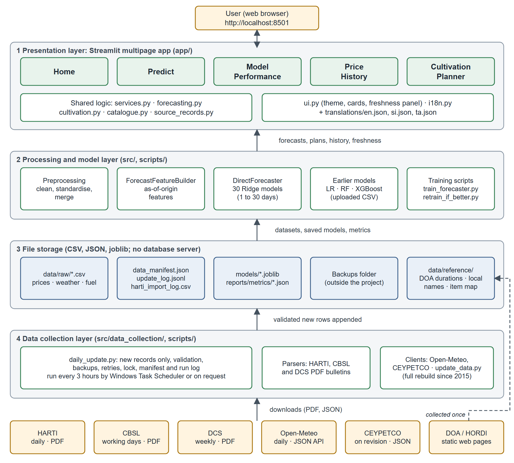

*Figure 4.1: Layered architecture of the system*

### 4.2 System Context

Figure 4.2 shows the system as a single process with its external entities and data flows. It serves as both the system context diagram and the level 0 data flow diagram. Six official or public sources supply data, the Windows Task Scheduler starts updates, the user makes requests and receives results, and the data maintainer runs the rebuild and retraining scripts.

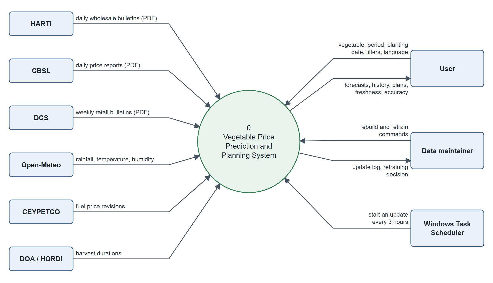

*Figure 4.2: System context diagram (data flow diagram, level 0)*

### 4.3 Use Cases

Figure 4.3 shows the use cases. The user's eight use cases correspond to the five pages and the language switcher. Generating a cultivation plan always includes the price comparison, and checking the sources on demand includes the same update process that the scheduler runs.

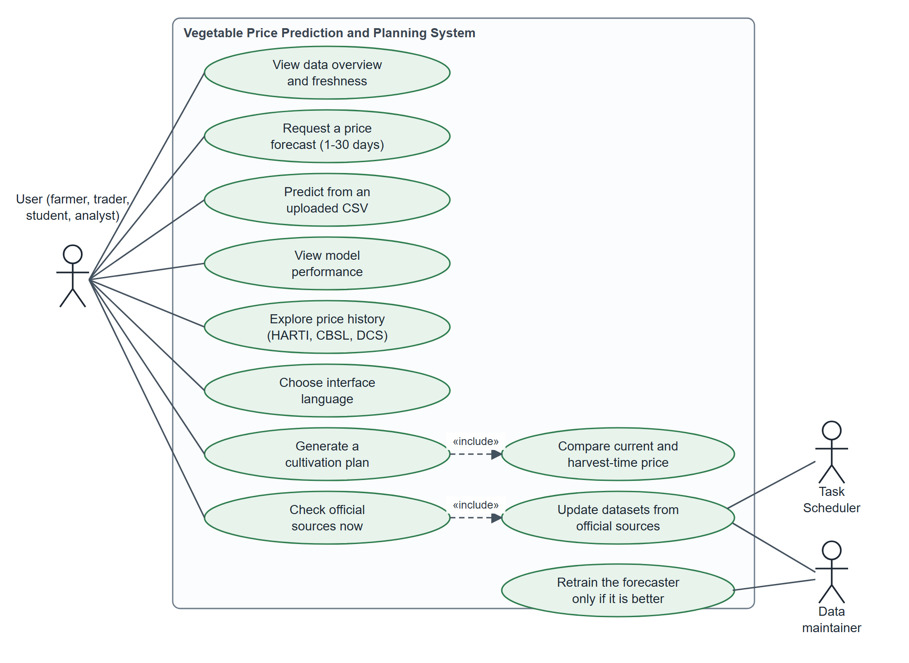

*Figure 4.3: Use case diagram*

**Table 4.1: Use case description: request a price forecast**

| Field | Description |
|---|---|
| Actor | User |
| Precondition | Stored datasets and the saved forecaster are readable |
| Main flow | 1. Open Predict. 2. Review the source status and latest records. 3. Choose a vegetable and a period (1, 7, 14 or 30 days, or a date up to 30 days ahead). 4. Select Predict. 5. The system shows the forecast in Rs/kg, a chart, and the measured errors for 1, 7, 14 and 30 days |
| Alternative flows | A series whose latest price is more than 30 days old is not offered, and the reason is listed. If a file is missing or damaged, the page names it and makes no real-data prediction |
| Postcondition | The forecast is displayed with its starting record, model and data sources; nothing is stored |

### 4.4 Data Flow

Figure 4.4 divides the system into six processes and four data stores. Collected data flows into D1 (price, weather and fuel datasets) and D2 (manifest and logs). Features built from D1 feed both training (process 3.0, which writes D3) and forecasting (process 4.0, which reads D3). The cultivation planner (5.0) combines the forecast with the reference data in D4 and the recorded prices. Presentation (6.0) reads the datasets, the logs and the saved metrics, which is how each page can show data freshness and measured accuracy.

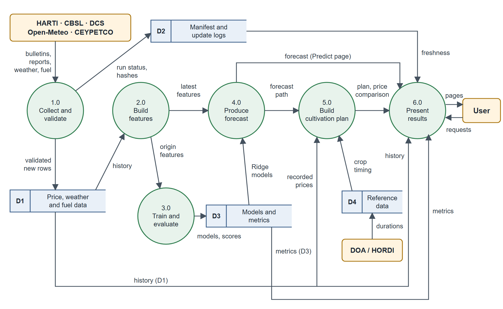

*Figure 4.4: Data flow diagram, level 1*

### 4.5 Data Source Integration

Each source has its own frequency, format and role (Table 4.2). Only HARTI prices, Open-Meteo weather and CEYPETCO fuel prices are model inputs. CBSL and DCS are kept as separate reference datasets, because they collect prices independently and measure different things; for example, on 13 November 2026 CBSL's Dambulla wholesale price for beans was Rs 375, while HARTI's for 12 November was Rs 430.

**Table 4.2: Data sources, publishing frequency and role**

| Source | Format | Real publishing frequency | Role |
|---|---|---|---|
| HARTI daily bulletin | PDF archive page | Daily including weekends; uploaded 1 to 3 days late at irregular times | Main price data; model target and inputs |
| CBSL Daily Price Report | PDF | Working days, same day | Reference (wholesale and retail, kept apart) |
| DCS weekly retail prices | PDF | Weekly; appears 3 to 20 days after its week starts | Reference (retail, Colombo District) |
| Open-Meteo historical archive | JSON API | Daily; archive runs a few days behind | Weather inputs for 8 locations |
| CEYPETCO fuel prices | JSON endpoint behind the official page | On each price revision | Fuel price inputs |
| DOA / HORDI crop pages | Web pages | Static reference | Harvest durations for the planner |

Figure 4.5 shows how a HARTI bulletin becomes stored rows. The same validation rules are used by the full rebuild and the incremental update. A bulletin that fails validation adds nothing, and its reason is logged.

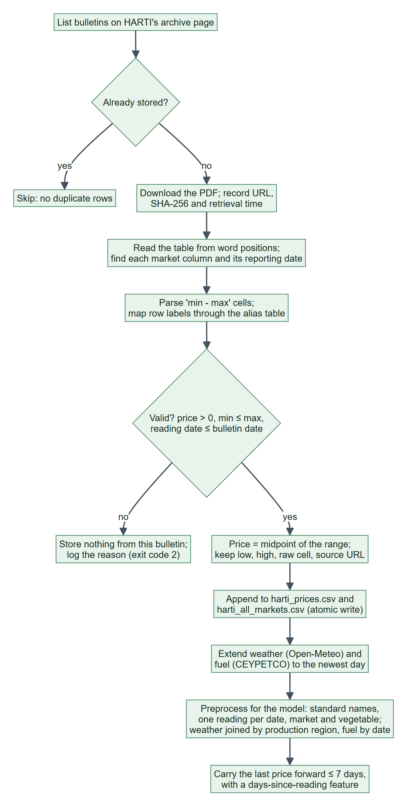

*Figure 4.5: Data collection and preprocessing workflow*

### 4.6 Machine Learning Pipeline

Figure 4.6 shows the training pipeline of the forecaster used by the application. Model type, regularisation and feature groups were chosen on four validation windows before the test period, and the chosen configuration was then scored once on the test period (14 May to 6 November 2026). The saved model was refitted on all data available on 6 November 2026. On 13 November 2026 a candidate trained on the full 2015-2026 history was checked by the retraining script and rejected, so the saved model was kept (Section 6.7).

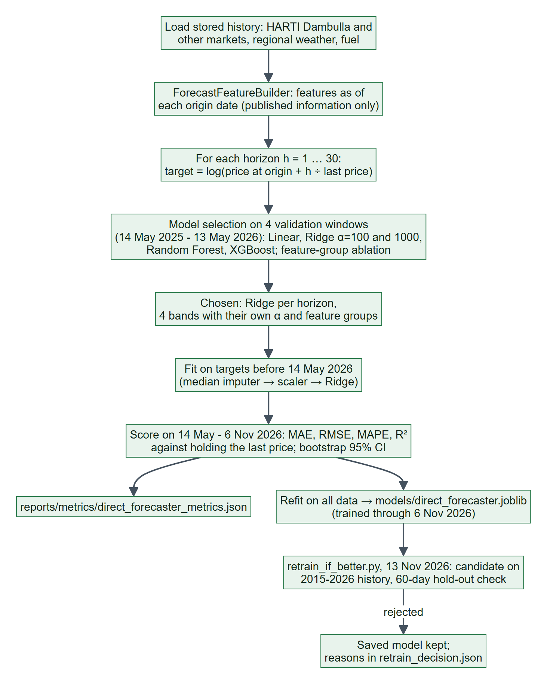

*Figure 4.6: Machine learning training pipeline*

### 4.7 Prediction Workflow

Figure 4.7 shows how a forecast is produced. Forecasts always count from the latest published price, not from today. The horizon h is the number of days from that price to the target date, and the model for each horizon predicts the change in price directly, so no forecast is fed back into another.

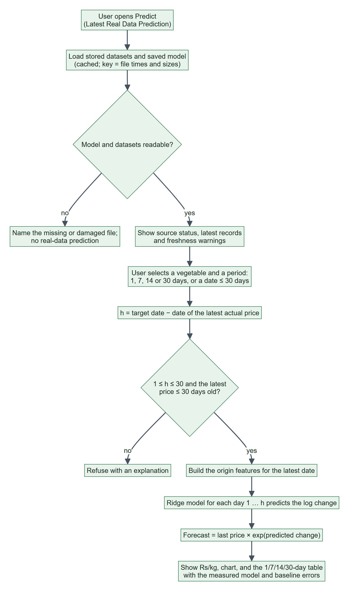

*Figure 4.7: Prediction workflow*

### 4.8 Automatic Update Workflow

Figure 4.8 shows one update run. A lock prevents two runs from overlapping, and a lock left by an interrupted run is detected and taken over. Each source is checked separately, so a source that cannot be reached is retried and then marked as failed, while the others are still updated. Files are backed up before any change and written atomically, so an interruption never leaves a half-written dataset.

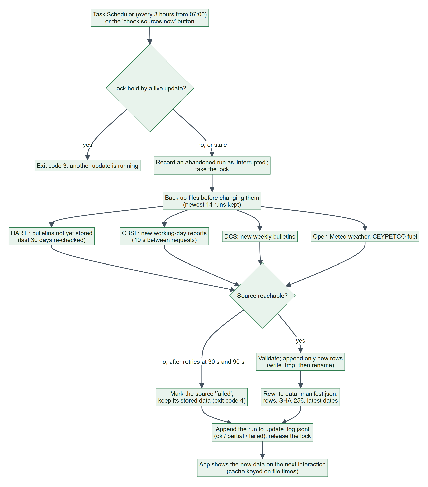

*Figure 4.8: Automatic data update workflow*

### 4.9 Multilingual Architecture

Figure 4.9 shows the language design. Every visible text in the code is written in English and passed through one function, t(). The English text itself is the key into three JSON files. The chosen language is held in the session and in the page address, so it survives reruns, page changes and reloads. Data values are never translated, so prices, dates and model inputs are identical in every language.

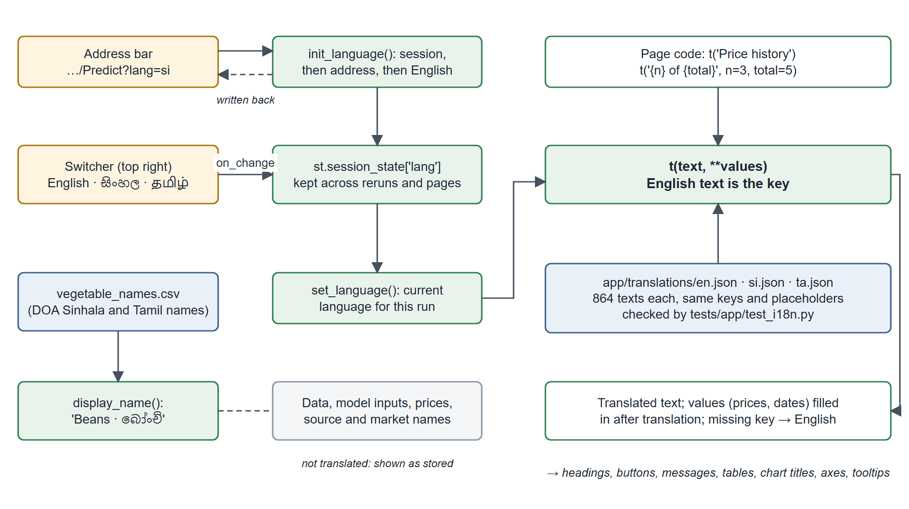

*Figure 4.9: Multilingual architecture*

### 4.10 Cultivation Planner Design

The planner combines published timing with prices (Figure 4.10). It never presents a price it does not have: a forecast is shown only when the harvest falls within the forecaster's 30-day reach; a harvest window that has passed shows the prices actually recorded; a harvest beyond the reach shows a seasonal reference from earlier years, labelled as not a forecast; and a crop without an official price series says so instead of showing Rs 0. The current price is compared only with a forecast or a seasonal reference.

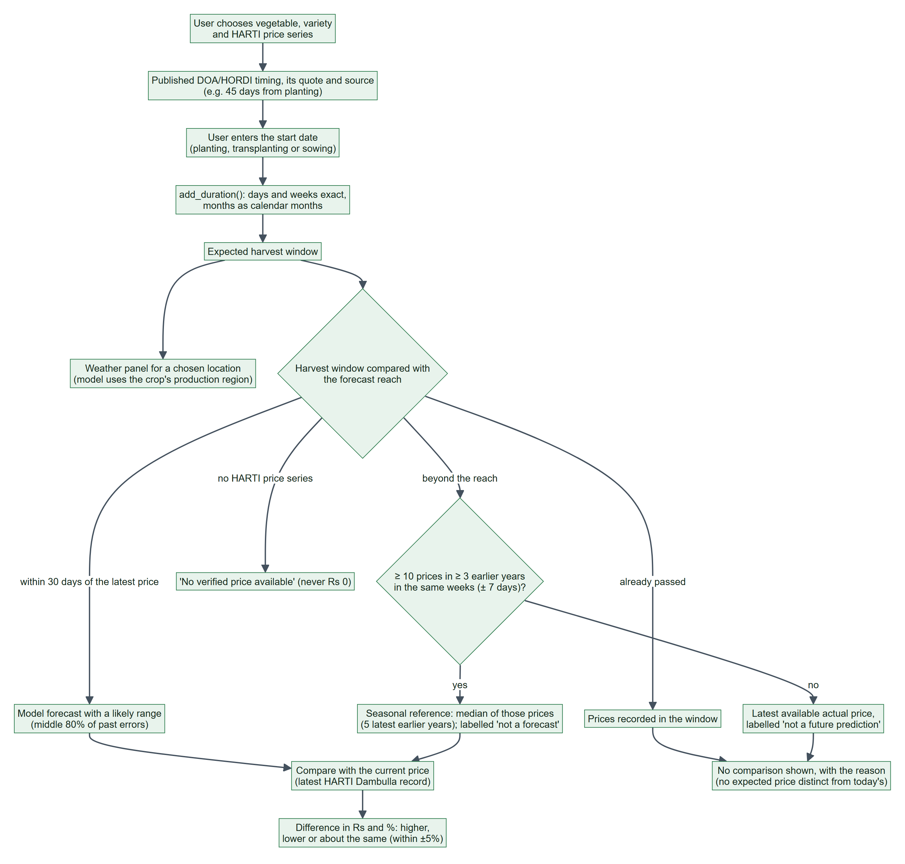

*Figure 4.10: Cultivation planner workflow*

### 4.11 Main User Workflow

Figure 4.11 shows a typical session as an activity diagram. The user can change the language at any point, and each task starts from the sidebar.

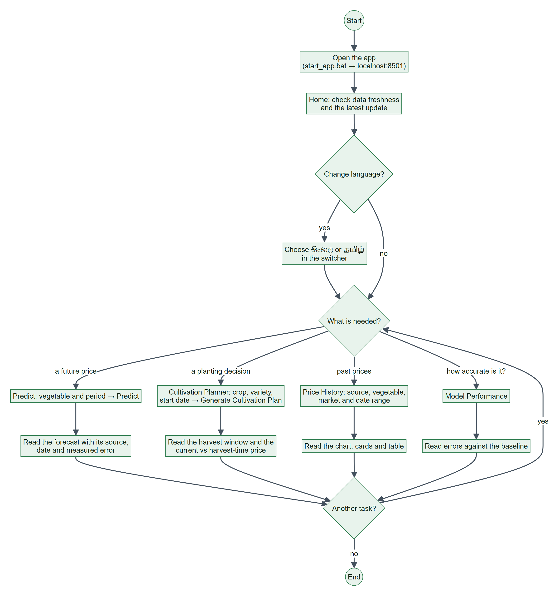

*Figure 4.11: Activity diagram of the main user workflow*

### 4.12 User Interface Design

The interface follows four principles:

1. **Every number has context.** A row of cards above each result shows the data source, market, price type and date of the latest data.
2. **Uncertain information is labelled.** Forecasts carry their measured error, dates that have passed are flagged, and history shown in place of a forecast is labelled as history.
3. **Consistent layout.** All pages share a dark theme with green accents, a header banner, stat cards, a data freshness panel and the language switcher at the top right.
4. **Readable in three languages and on small screens.** Sinhala and Tamil use system fonts that support those scripts (Nirmala UI on Windows), chart dates are numeric in Sinhala and Tamil, and the layout adapts to a phone-sized screen.

## 5. Implementation

### 5.1 Development Environment

The system was developed on Windows 11 in a Python 3.12.10 virtual environment (.venv312), using PowerShell and Git. Exact package versions are pinned in requirements.txt, and file paths, model settings and source addresses are kept in config/config.yaml. The application is started with start_app.bat, which runs streamlit run app/Home.py and opens http://localhost:8501.

### 5.2 Technology Stack

**Table 5.1: Technology stack**

| Area | Technology (version) | Purpose |
|---|---|---|
| Language | Python 3.12.10 | All components |
| Web application | Streamlit 1.66.1, Altair 6.3.0 | Pages, widgets and interactive charts (Streamlit Inc., 2026) |
| Data processing | pandas 3.1.0, NumPy 2.5.4 | Data frames and numerical work (McKinney, 2010; Harris et al., 2020) |
| Machine learning | scikit-learn 1.9.1, XGBoost 3.4.1 | Ridge, Linear Regression, Random Forest; gradient boosting (Pedregosa et al., 2011; Chen and Guestrin, 2016) |
| PDF reading | PyMuPDF 2.1 | Word positions and tables in bulletin PDFs (Artifex Software, 2026) |
| Web access | requests 2.34.2, Beautiful Soup 4.15.0 | Downloading pages and reading archive tables |
| Persistence | joblib 1.6.0, CSV, JSON | Saved models, datasets, manifest and logs |
| Charts | Matplotlib 3.11.2, Altair | Report figures and application charts |
| Testing | pytest, Streamlit AppTest | Unit, integration and page tests |
| Scheduling | Windows Task Scheduler | Automatic updates every 3 hours |

The code is organised into reusable packages in src/ (data collection, preprocessing, feature engineering, models and prediction), the Streamlit application in app/, command-line tasks in scripts/ and tests in tests/. In total there are about 7,200 lines of Python in app/, 6,200 in src/, 3,900 in scripts/ and 11,400 in tests/.

### 5.3 Data Collection

**HARTI bulletins.** HartiLiveClient reads the archive page, which lists one bulletin per day in a table per year, and opens each PDF with PyMuPDF. PyMuPDF's own table extraction scrambled dates and removed spaces from labels in these PDFs, so the parser reads each cell from the positions of the words on the page and uses the table extraction only as a cross-check. A cell such as "190.00 - 210.00" is parsed into a minimum and maximum, and the stored price is the midpoint of that range, because HARTI publishes a range rather than one price. Row labels are mapped to project names through an alias table, and an unknown label is reported rather than guessed.

The 2015 to 2021 bulletins needed extra handling: different spellings of market names ("Kappetipola", "T'thegama"), Pettah being replaced by Peliyagoda, and merged label cells spanning several rows, which the function split_merged_label_rows assigns line by line. Each market column also has its own reporting date; a reading is accepted only if it is dated on or before its bulletin and within the market's usual reporting lag. The full rebuild read 3,105 bulletins; 224 could not be used, mostly from 2022 and 2023 when HARTI used a one-page layout, and the reason for each is recorded in harti_prices_build_report.json.

**CBSL and DCS.** The CBSL parser finds the "Wholesale and Retail Prices" table, checks the report date against the file name, and assigns each "Today" column to a market and price type from the printed headings, never from fixed positions. Values printed as "n.a." stay missing. The DCS parser reads the weekly averages; DCS dates its bulletins as "week n of a month", so no calendar date is invented for them.

**Weather and fuel.** Daily rainfall, mean temperature and humidity come from the Open-Meteo historical archive (Zippenfenig, 2023), which is based mainly on the ERA5 reanalysis (Hersbach et al., 2020), for Dambulla and seven production regions. Fuel prices are each published CEYPETCO revision of auto diesel and petrol 92, repeated daily until the next revision.

Table 5.2 shows the stored datasets on 17 November 2026, read from data_manifest.json.

**Table 5.2: Stored datasets on 17 November 2026**

| Dataset | Rows | First | Latest |
|---|---|---|---|
| harti_prices.csv (Dambulla, 35 series) | 76,954 | 2015-06-22 | 2026-11-17 |
| harti_all_markets.csv (11 markets) | 528,587 | 2015-06-22 | 2026-11-17 |
| cbsl_daily_prices.csv (wholesale and retail) | 10,187 | 2026-09-01 | 2026-11-17 |
| dcs_weekly_retail_prices.csv | 11,439 | 2019-12 week 4 | 2026-11 week 1 |
| fuel_prices.csv | 4,167 | 2015-06-22 | 2026-11-17 |
| weather_data_by_region.csv (8 locations) | 33,312 | 2015-06-22 | 2026-11-14 |
| doa_harvest_durations_v2.csv (24 crops) | 77 | Static | Static |

Coverage differs by year (Figure 5.1). Before 2022 HARTI usually published on weekdays only, and in 2022 and 2023 many bulletins used the one-page layout that the parser does not read. In total 2,923 of the 4,167 calendar days have a Dambulla price.

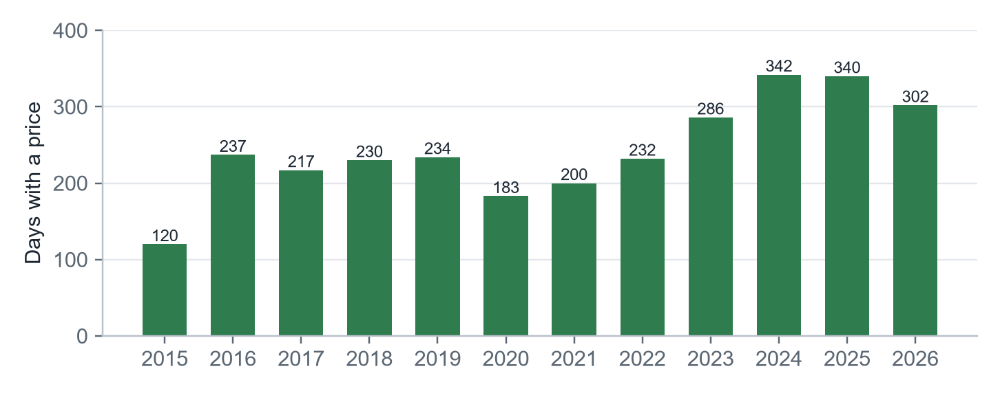

*Figure 5.1: Days with a HARTI Dambulla price, by year (2026 to 17 November)*

Figure 5.2 shows weekly mean prices for three common vegetables. Prices rose sharply from 2022 and remain more volatile than before; the carrot peak in early 2024 is followed by repeated short spikes.

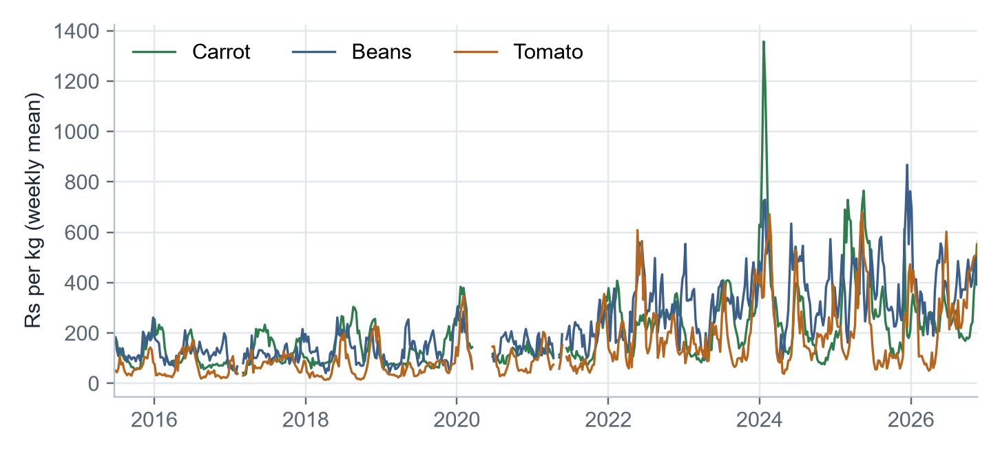

*Figure 5.2: Weekly mean HARTI Dambulla wholesale prices of carrot, beans and tomato, June 2015 to November 2026*

### 5.4 Data Preprocessing

Preprocessing (src/preprocessing) validates, cleans and merges the data:

1. **Validation at load time:** required columns, types, date formats and value ranges (for example rainfall must be non-negative and humidity between 0 and 100%).
2. **Name standardisation:** vegetable and market names are mapped to one form. HARTI's "Eggplant" row is called "Brinjal" and is kept separate from HARTI's "Brinjals" row.
3. **De-duplication:** one reading per date, market and vegetable. A bulletin that has already been stored is never read again.
4. **Merging:** prices are joined to weather by date and production region, and to fuel by date, with prices on the left of every join so that no price is lost.
5. **Missing values:** missing price days are not filled in the stored data. When features are built, the last price is carried forward for at most seven days, with a days-since-reading feature that tells the model how old it is.

Production regions come from config/crop_production_regions.yaml, which maps 14 vegetables to one evidenced region (for example carrot to Nuwara Eliya); the others use the weather at Dambulla.

### 5.5 Feature Engineering

The direct forecaster asks: standing on an origin date, with only what had been published by then, what will the price be h days later? ForecastFeatureBuilder builds the feature groups in Table 5.3 as of each origin date. Prices from other markets are keyed by the date of the bulletin that published them, not by the market's reporting date, because some markets (such as Meegoda and Veyangoda) are reported one to three days late; using the reporting date would leak information.

**Table 5.3: Feature groups of the direct forecaster**

| Group | Features | Meaning |
|---|---|---|
| level | log of the latest price | Current price level |
| momentum | log changes over 1-30 days; position relative to 7-30 day means; volatility; days since reading | Recent direction and stability |
| market | median daily change of all vegetables; 7-day sum | Movement of the whole market |
| other_markets | premium of six other markets over Dambulla; change of their median; dispersion | Prices already published elsewhere |
| rain_windows | rain over 3-30 days; mean temperature; humidity | Recent weather in the production region |
| weather_lag_14 | rain, temperature and humidity 14 days before the target | Delayed effect of weather on supply |
| fuel | 30-day change in diesel and petrol prices | Transport cost pressure |
| calendar | target day of week; sine and cosine of day of year | Weekly and seasonal pattern |

### 5.6 Machine Learning Implementation

The DirectForecaster class (src/models/direct_forecaster.py) trains one scikit-learn pipeline per horizon from 1 to 30 days: a median imputer, a standard scaler and a Ridge regressor. The target is the logarithm of the price change, log(price at origin + h / latest price), which makes vegetables with very different price levels comparable. The forecast is converted back to rupees by multiplying the latest price by the exponential of the predicted change. The 30 horizons are grouped into four bands, each with its own Ridge penalty and feature groups (Table 5.4), chosen from the validation experiments in Section 6.7.

**Table 5.4: Forecast bands of the saved forecaster**

| Days ahead | Ridge α | Feature groups |
|---|---|---|
| 1 | 1000 | momentum, level, market, fuel, weather_lag_14, other_markets |
| 2-10 | 1000 | momentum, rain_windows, weather_lag_14, level, other_markets |
| 11-21 | 1000 | rain_windows, market, level, other_markets |
| 22-30 | 100 | momentum, calendar, rain_windows, market, level |

The training call accepts a target_before date. When it is set to the test start date, no row whose target falls in the test period can enter training, which is what makes the evaluation honest. The earlier one-day-ahead models (Linear Regression, Random Forest and XGBoost on 51 features, trained by scripts/train.py with a chronological 80/20 split) are kept as the comparison and are used only for uploaded CSV files, because the direct forecaster needs other markets' prices and regional weather that an upload does not have.

### 5.7 Model Evaluation Approach

All test scores come from models trained only on targets before 14 May 2026 and scored on targets from 14 May to 6 November 2026. Four metrics are reported: MAE (the average absolute error in Rs/kg), RMSE (which weighs large errors more), MAPE (the error relative to the price) and R². Every result is compared with the hold-last-price baseline, and the improvement in MAE is given with a 95% confidence interval from 2,000 bootstrap resamples of whole forecast dates (Efron and Tibshirani, 1993). Whole dates are resampled because vegetables on the same date tend to move together.

### 5.8 Streamlit Application

The application consists of app/Home.py and four pages. Shared styling and components live in app/ui.py, and logic that does not depend on Streamlit (loading data, building plans, checking freshness) lives in separate modules so that it can be tested with plain pytest. Because Streamlit reruns a page on every interaction, data and models are cached. The cache key includes a data version computed from the files' modification times and sizes (data_version() in app/catalogue.py), so new data from an update appears on the next interaction without restarting the application. The sidebar navigation is drawn by the application itself, so that its page names can be translated.

### 5.9 Home Dashboard

The Home page (Figure 5.3) summarises the forecaster's measured accuracy (next-day MAE Rs 17.47, 4.3% lower than holding the price, 31 vegetables), then shows the data freshness panel (Figure 5.4). For each source it gives the type of data, location, latest data date, last successful check and one of five statuses: Latest Available Data, Recently Updated (new records within 24 hours), Update Pending, Source Unavailable or Historical Data. Below this, the page lists every dataset in use from the manifest, reports the last update run and the latest retraining decision (Figure 5.5), and offers a button to check the official sources immediately.

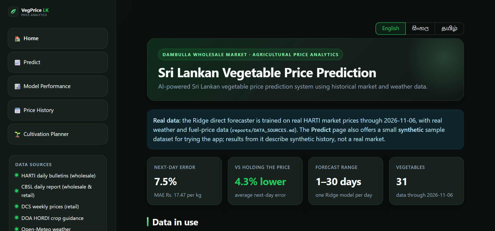

*Figure 5.3: Home dashboard (English), captured on 18 November 2026 with data to 17 November 2026*

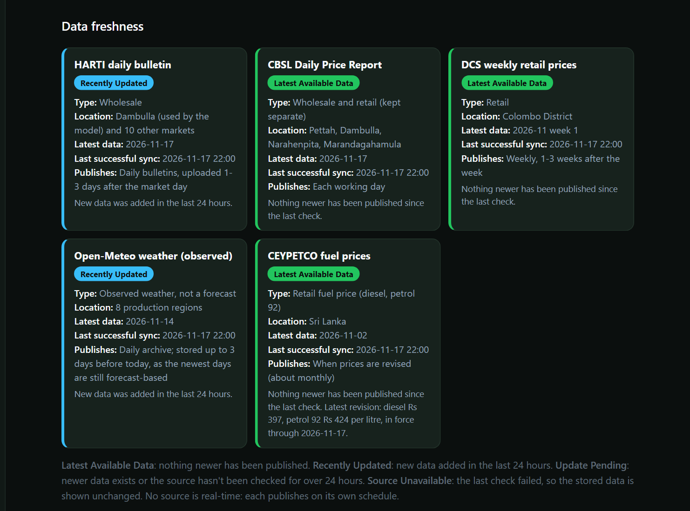

*Figure 5.4: Data freshness panel on the Home page*

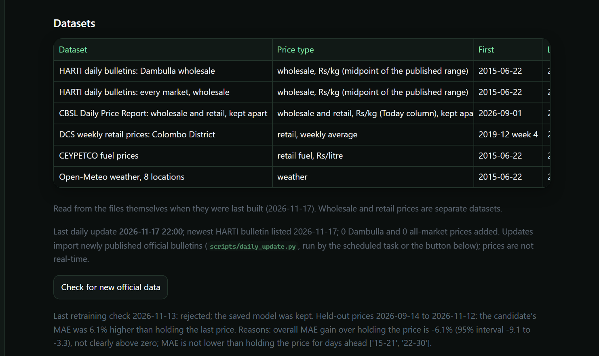

*Figure 5.5: Datasets in use, last automatic update and retraining decision on the Home page*

### 5.10 Price Prediction Module

The Predict page offers two data sources: Latest Real Data Prediction (the default, using the official records and the direct forecaster) and Upload CSV (using only the uploaded file and the earlier model). For official data the page has five sections. Section 1 (Figure 5.6) shows the status of HARTI, CBSL and DCS: the newest publication found, the last check, whether new data arrived and whether a source is behind schedule. Section 2 lists the latest collected records source by source, with every field the source publishes. Sections 3 and 4 select the vegetable and the forecast period, and section 5 lists freshness warnings.

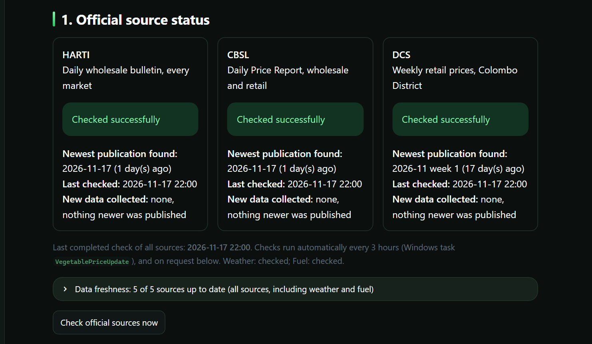

*Figure 5.6: Predict page: official source status*

Figure 5.7 shows a 7-day forecast for beans, captured on 18 November 2026. The forecast counts from the latest HARTI Dambulla price (Rs 450.00 on 17 November 2026) and is Rs. 463.04 for 24 November 2026. The table below the chart (Figure 5.8) shows the forecasts for 1, 7, 14 and 30 days together with the model's measured MAE and the baseline's MAE for each range, so the user can judge how much to trust each number. Series whose latest price is more than 30 days old, or which the model was not trained on, are not offered, and an expandable panel lists them with the reason.

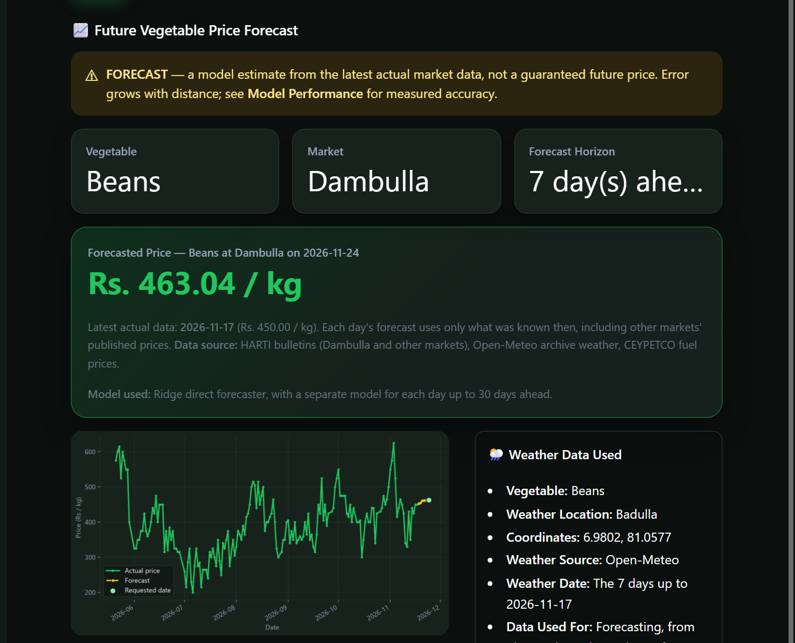

*Figure 5.7: Predict page: 7-day forecast for beans from the latest official price*

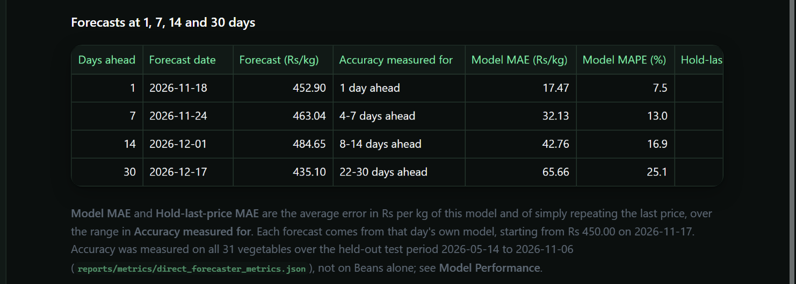

*Figure 5.8: Predict page: forecasts at 1, 7, 14 and 30 days with the measured errors of the model and the baseline*

### 5.11 Model Performance Module

The Model Performance page (Figure 5.9) presents the saved evaluation from reports/metrics: the error by forecast range for the model and the baseline, a next-day comparison on identical rows, results by vegetable, the earlier models and the recursive-versus-direct comparison. All values are read from the saved JSON reports, never recalculated in the page.

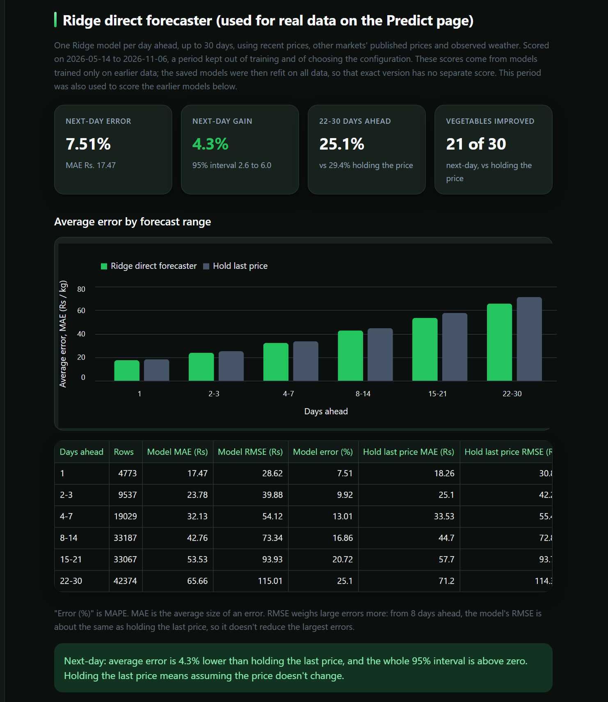

*Figure 5.9: Model Performance page*

### 5.12 Price History Module

The Price History page offers three sources that are never combined in one chart, because they measure different things. HARTI daily wholesale prices can be shown for any market and date range, with summary cards and the weather for the vegetable's region (Figure 5.10). The CBSL view compares wholesale or retail prices for Pettah, Dambulla and Narahenpita in one chart (Figure 5.11), and the DCS view shows weekly retail prices for Colombo District. Each chart has a table view, and gaps longer than seven days break the line so that missing data is not hidden.

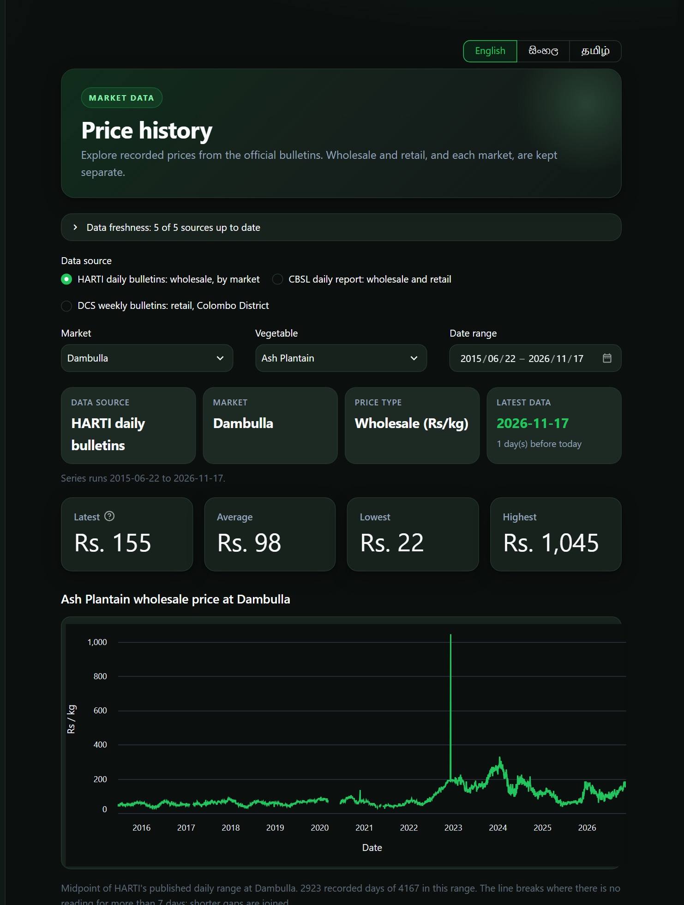

*Figure 5.10: Price History: HARTI wholesale prices at Dambulla*

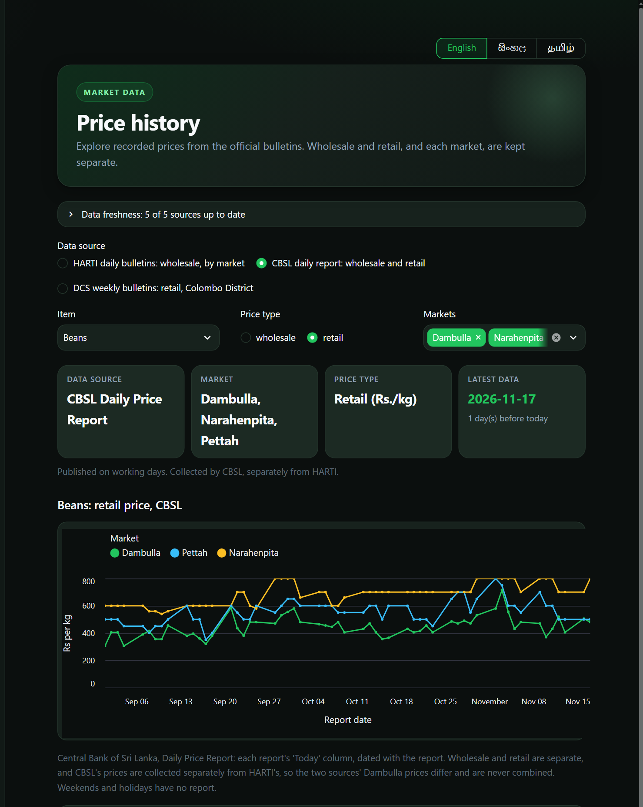

*Figure 5.11: Price History: CBSL retail prices compared across three markets*

### 5.13 Cultivation Planner

The planner asks for a vegetable, a variety or general crop guidance, the HARTI price series and the start date that the published timing counts from (Figure 5.12). The date label follows the source: "Planting date", "Transplanting date", "Nursery sowing date" or, when the DOA page does not say, a warning that the start stage is not stated. The published duration and the exact quoted sentence are shown with their source. Before a plan is generated, the page states the latest start date whose harvest can still receive a forecast.

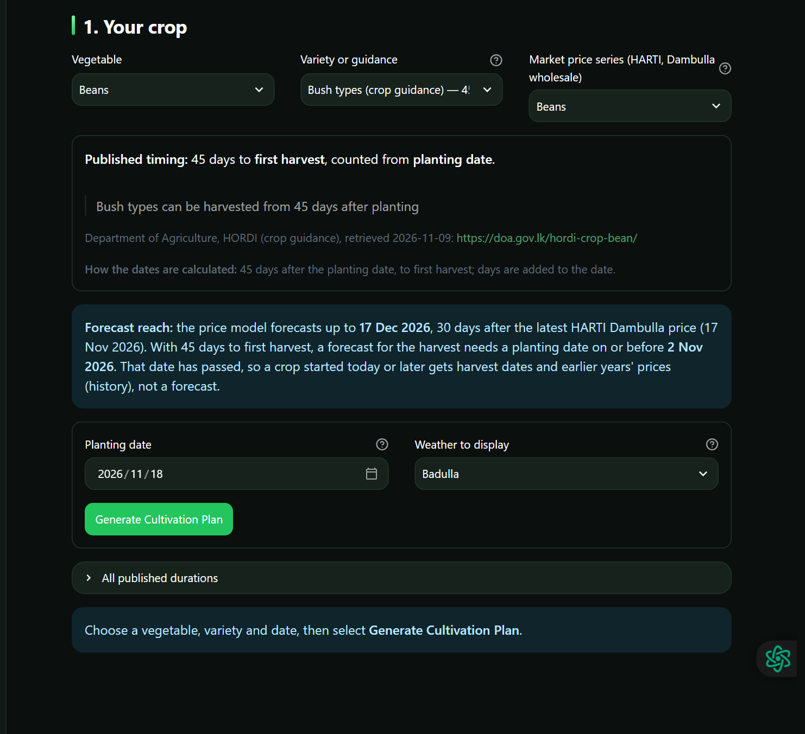

*Figure 5.12: Cultivation Planner: crop selection and the published timing*

Dates are calculated by add_duration in app/cultivation.py. Days and weeks are added exactly, months are calendar months, and a half month is the day halfway between the two whole months around it; no month is assumed to be 30 days. The 77 published timings are stored in data/reference/doa_harvest_durations_v2.csv with the duration exactly as published, the stage it counts from, the source address and the quoted sentence.

The price section compares two clearly labelled numbers (Figure 5.13). The current market price is the latest HARTI Dambulla record, with its date, age and the published minimum to maximum. The expected harvest-time price is a model forecast with a likely range (the middle 80% of measured forecast errors) when the harvest is within reach. The difference is given in rupees and as a percentage, and the direction is described as higher, lower or about the same (within ±5%). When today's price lies inside the forecast's likely range, the page says that the change is within normal forecast error. For a planting date of 10 October 2026, beans (bush types, 45 days) are expected to be ready on 24 November 2026, with a forecast of Rs. 463.04 against a current price of Rs 450.00, a difference of +Rs 13.04 (+2.9%), which the page describes as about the same as today's price; today's price also lies inside the forecast's likely range of Rs 383.54 to 599.17.

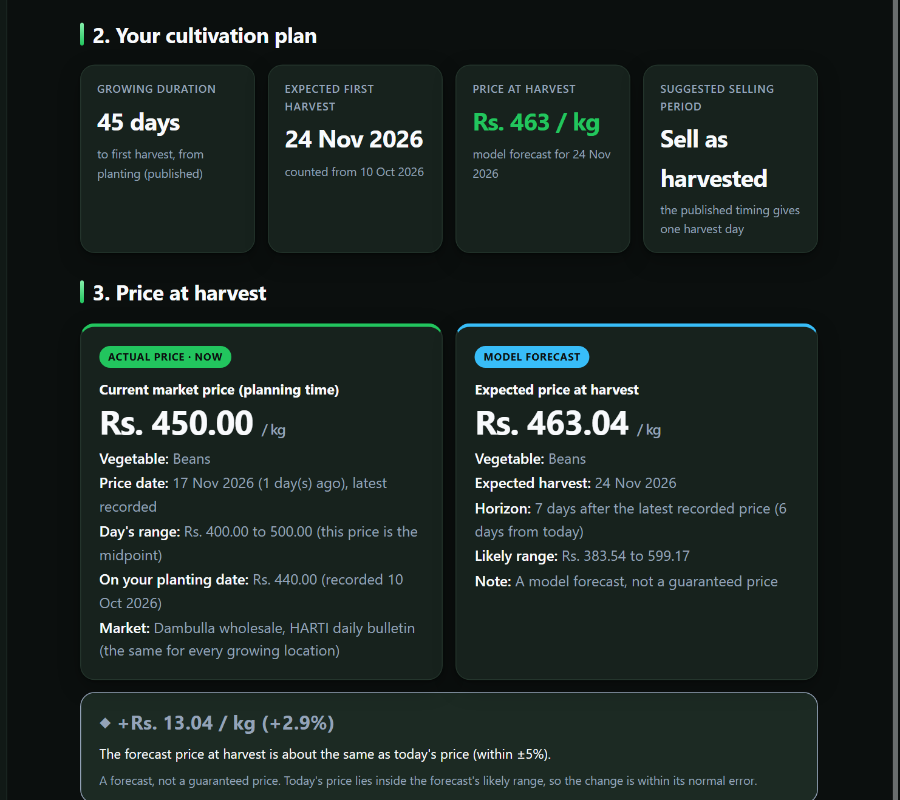

*Figure 5.13: Cultivation Planner: current price compared with the forecast harvest-time price*

When the harvest falls beyond the 30-day reach, the planner shows the median price in the same weeks (± 7 days) of the five most recent earlier years, with the number of prices and years used, labelled "Seasonal reference · not a forecast" (Figure 5.14). For beans planted on 18 November 2026, the harvest on 2 January 2027 is 46 days after the latest price, so the planner shows a typical price of Rs 387.50 (the median of 62 prices in the same weeks of 2021-2026, not adjusted for inflation), Rs 62.50 (13.9%) lower than today's price. At least 10 prices from at least 3 years are required; otherwise it shows the latest actual price, labelled as not a prediction. A crop without a HARTI series, such as cauliflower, receives harvest dates but no price. The planner does not estimate cultivation cost, yield, revenue or profit; no data for these was available.

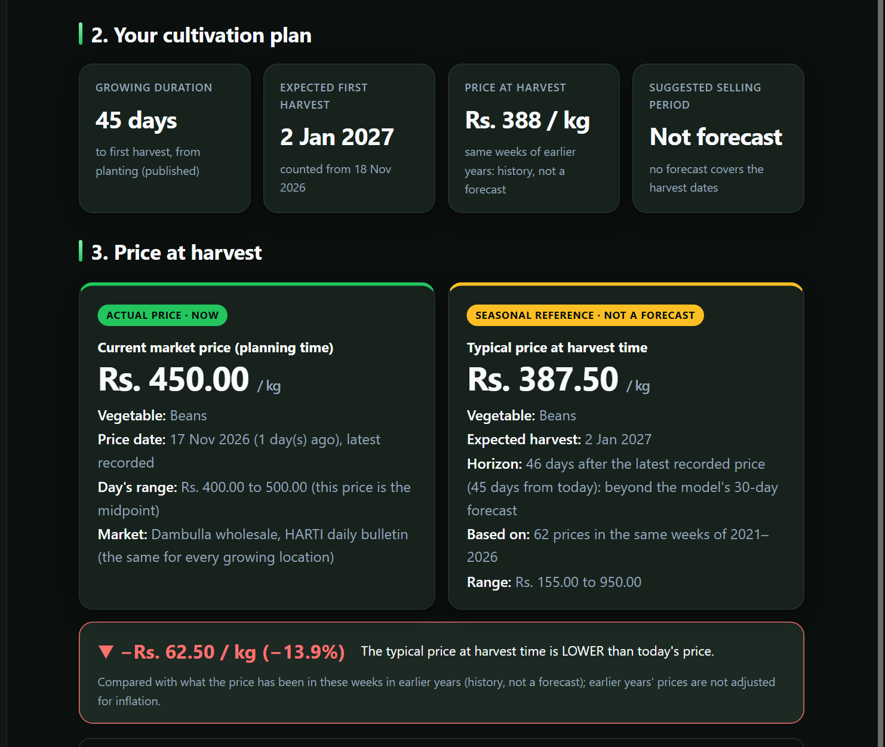

*Figure 5.14: Cultivation Planner: harvest beyond the forecast reach with a labelled seasonal reference*

### 5.14 Automatic Data Updates

scripts/daily_update.py is run every three hours from 07:00 by the Windows task VegetablePriceUpdate, and can also be started from the Home or Predict page. Since 17 November 2026 the task starts it without a console window, because closing such a window had stopped four runs part-way. The script:

- reads only bulletins that are not yet stored, re-checking the last 30 days, so a run never creates duplicates and a second run on the same day adds nothing;
- validates every row (positive prices, minimum not above maximum, reading date on or before its bulletin) and stores nothing from a bulletin that fails;
- backs up each file before changing it (keeping the newest 14 runs), writes to a temporary file and renames it, and never changes stored rows;
- checks each source separately, retrying an unreachable source after 30 and 90 seconds before recording it as failed, so one failure does not stop the others;
- takes a lock that names its process, so a lock left by an interrupted run is recognised, recorded as "interrupted" and taken over;
- rewrites data_manifest.json (rows, SHA-256 hash and latest dates of each dataset) and appends one line per run to update_log.jsonl with each source's status.

The freshness rules allow for each source's real schedule. On the Predict page, a source is marked as behind schedule when its newest publication is older than 3 days (HARTI), 4 days (CBSL) or 21 days (DCS); the 21-day limit for DCS came from the creation dates of 16 pairs of consecutive DCS bulletins, which showed that a new week can take up to 20 days to appear. The last run before the screenshots were taken, at 22:00 on 17 November 2026, checked all five sources successfully; the newest HARTI bulletin was dated 17 November 2026. All datasets, figures and results in this report are a snapshot of that state.

### 5.15 Multilingual Implementation

app/i18n.py provides t("English text", **values). The English text is the key, so English output is exactly what the code says, and a text without a translation falls back to English rather than showing a code. Values such as prices and dates are inserted after translation, so they are never altered. The three files in app/translations hold 864 texts each with identical keys and placeholders. Of the Sinhala and Tamil entries, 59 are intentionally identical to the English: 55 cultivar names and the metric names MAE, RMSE and R².

The language is chosen with a switcher at the top right of every page (Figure 5.15). The choice is stored in the session and in the address (?lang=si or ?lang=ta), so it persists across reruns, page changes, reloads and bookmarks, with English as the default. Vegetable names keep the familiar English name and add the local name from the DOA's lists, for example "Beans · බෝංචි". Month names are translated in dates, and charts in Sinhala and Tamil use numeric dates (2026-11-17) because the charting library would otherwise print English month names (Figure 5.16, Figure 5.17). Data values, source names (HARTI, CBSL, DCS, CEYPETCO, Open-Meteo), market and cultivar names, the DOA's quoted English sentences and file names are deliberately not translated.

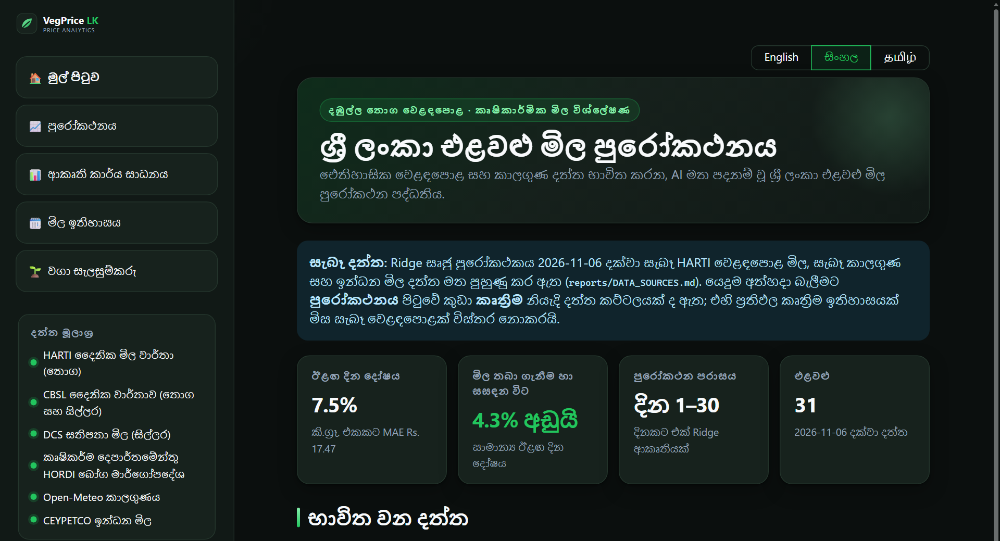

*Figure 5.15: Language switcher at the top right; the Home page after choosing Sinhala*

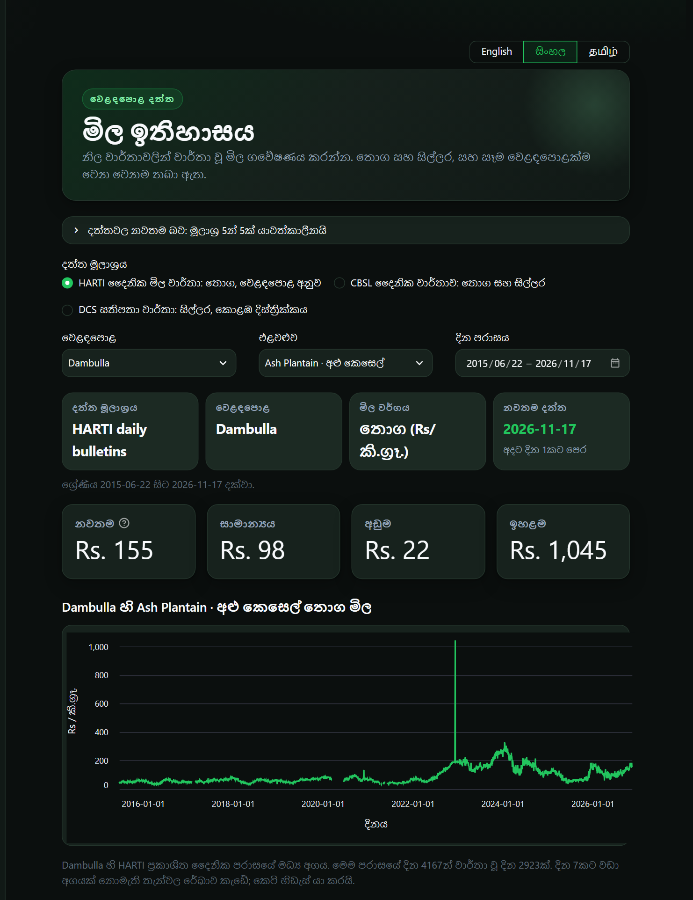

*Figure 5.16: Price History in Sinhala, with translated chart title, axes and cards*

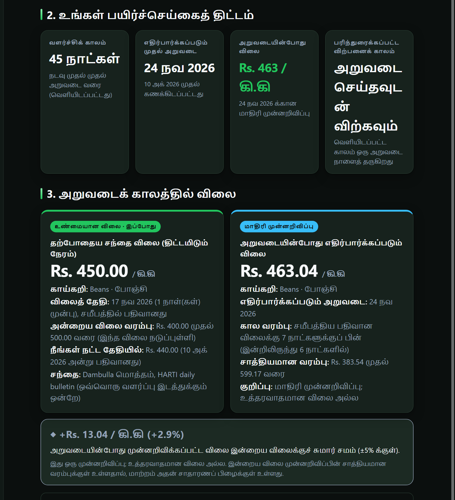

*Figure 5.17: Cultivation Planner in Tamil; the prices are identical to the English plan*

### 5.16 Error Handling

Errors are reported in the interface rather than allowed to crash a page. Missing or damaged datasets and model files are named individually with instructions for rebuilding them. Forecast requests outside the supported range raise ForecastInputError or ForecastDataUnavailableError, which the page shows as an explanation. An uploaded CSV without a required column is rejected with the missing column and the columns found (Figure 5.18). A failed update keeps the stored data and is reported on the Home and Predict pages with the reason.

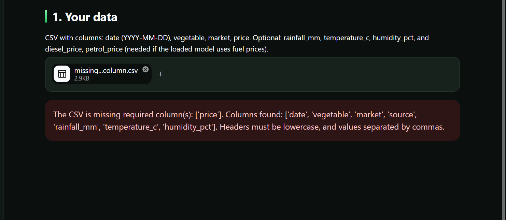

*Figure 5.18: Predict page: an uploaded CSV without a price column is rejected with a clear message*

## 6. Testing and Results

### 6.1 Testing Strategy

Testing was carried out at four levels (Table 6.1). Automated tests use pytest and mirror the source folders; several use real bulletins saved as fixtures, such as the HARTI bulletins of 22 June 2015 and 9 November 2026 and the CBSL reports of 4 August 2021 and 9 November 2026, so the parsers are tested on genuine documents. Pages are tested with Streamlit's AppTest, which runs a page script without a browser. Browser tests were run by a script that drives headless Microsoft Edge against the running application, records what each page shows and saves a screenshot. No manual user testing with farmers or traders was carried out.

**Table 6.1: Testing levels**

| Level | Tool | What it covers |
|---|---|---|
| Unit tests | pytest | Functions and classes: parsers, features, date arithmetic, metrics, translation helper |
| Integration tests | pytest | Complete chains: daily update in a temporary folder, training script, prediction pipeline, dataset integrity |
| Page tests | Streamlit AppTest | Every page runs, in all three languages, with real data |
| Browser tests | Headless Edge (scripted) | The running application as a user sees it: navigation, forecasts, planner, language switching, layout |
| Data validation | scripts/validate_real_datasets.py | Stored prices against the original PDFs |
| Model evaluation | scripts/train_forecaster.py | Accuracy on a held-out test period against the baseline |

### 6.2 Automated Test Results

The complete suite was run on 17 November 2026 with python -m pytest. All 1,320 test cases passed, with no failures, errors or skips, in 714.97 seconds; the run took longer than usual because the browser tests were running at the same time. The 353 warnings were deprecation notices from libraries and do not affect results. Table 6.2 shows the distribution.

**Table 6.2: Automated test results by area, 17 November 2026**

| Test folder | Test modules | Test cases | Passed | Failed |
|---|---|---|---|---|
| tests/app | 18 | 866 | 866 | 0 |
| tests/data_collection | 10 | 175 | 175 | 0 |
| tests/feature_engineering | 11 | 120 | 120 | 0 |
| tests/models | 9 | 57 | 57 | 0 |
| tests/prediction | 3 | 35 | 35 | 0 |
| tests/preprocessing | 4 | 29 | 29 | 0 |
| tests/scripts | 4 | 38 | 38 | 0 |
| **Total** | **59** | **1,320** | **1,320** | **0** |

### 6.3 Unit and Integration Testing

Unit tests check behaviour that is easy to get wrong. For example, test_changing_any_later_data_moves_no_earlier_feature changes all data after a chosen date and checks that no feature on or before that date changes, which proves the absence of look-ahead leakage; test_target_before_excludes_later_targets_from_training checks that test-period targets never enter training; and test_no_month_is_treated_as_30_days checks the planner's calendar arithmetic. Integration tests run complete chains. test_daily_update.py runs the updater against a real bulletin in a temporary folder and checks that new rows are added, stored rows are untouched, a second run adds nothing, an unreadable bulletin writes nothing, an interrupted run's lock is taken over and logged, and an unreachable source is retried and then recorded without stopping the others.

### 6.4 Functional and User Interface Testing

The browser tests exercised every page of the running application on 18 November 2026 (00:15 to 00:24) at 1280 pixels wide, plus a phone-sized screen. Table 6.3 summarises them; Appendix A lists each test with its steps, expected and actual results and evidence.

**Table 6.3: Browser test summary**

| Area | Tests | Passed | Failed |
|---|---|---|---|
| Startup and navigation | 2 | 2 | 0 |
| Data freshness | 1 | 1 | 0 |
| Automatic updates | 1 | 1 | 0 |
| Multilingual | 9 | 9 | 0 |
| Prediction | 6 | 6 | 0 |
| Model performance | 1 | 1 | 0 |
| Price history | 5 | 5 | 0 |
| Cultivation planner | 5 | 5 | 0 |
| **Total** | **30** | **30** | **0** |

### 6.5 Data Validation Testing

The extracted data was validated against the original PDFs by scripts/validate_real_datasets.py, using methods independent of the extraction code:

- A random sample of 42 Dambulla records (14 per calendar year, 2024-2026) was re-read from the PDFs by page position alone: 42 of 42 matched, and image crops of the original cells were saved for checking by eye.
- All 184,996 all-market readings for 2024 to 2026 were compared with a separate table-based reading of the 870 PDFs: all matched, with no price differences and nothing found in only one source.
- A random sample of 40 readings, four per market, was re-read by position: 40 of 40 matched.

When the archive was extended back to 2015, the rebuilt data was first written to a separate folder and compared with the validated 2024-2026 data: all 23,809 Dambulla and 184,996 all-market readings were identical. The 2015-2023 data was checked through tests on sample bulletins from those layouts, not by a full independent comparison.

### 6.6 Multilingual Testing

tests/app/test_i18n.py (24 tests) checks that the three translation files have exactly the same keys and placeholders, that every Sinhala and Tamil entry is really in Sinhala or Tamil script, that every text the code passes to t() has a translation, and that no page shows an untranslated literal. It runs every page in Sinhala and Tamil, checks that the language follows the address, reruns, navigation and the switcher, and checks that the planner's prices are identical in all three languages. Browser tests BT-30 to BT-38 confirmed the same behaviour in the running application, including no English month names on Sinhala or Tamil chart axes and no sideways scrolling at phone width (Figure 6.1).

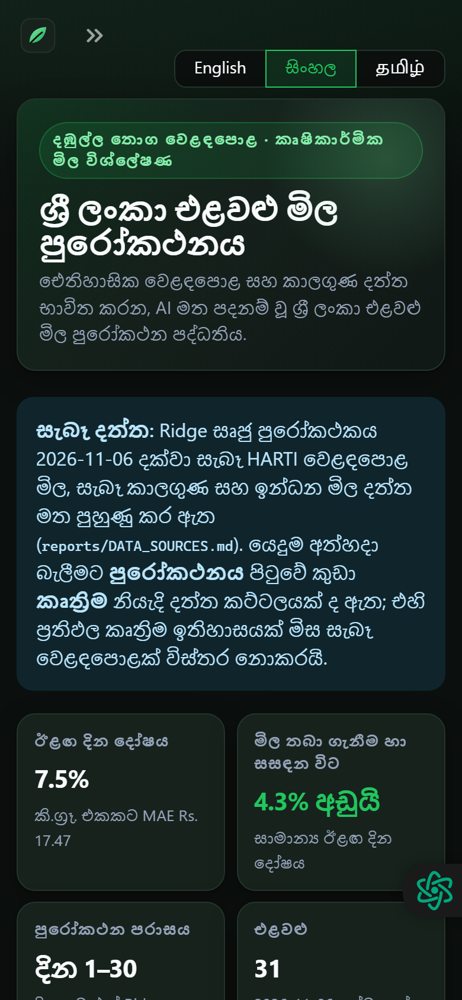

*Figure 6.1: Sinhala Home page on a phone-sized screen (390 pixels wide)*

### 6.7 Model Evaluation Results

#### 6.7.1 Earlier one-day models

The three models designed in the interim report were evaluated on a chronological test set of 3,915 rows after training on 13,749 rows (Table 6.4, Figure 6.2). Linear Regression was selected for its lowest RMSE, but none of the three beat simply using yesterday's price. Their R² of about 0.96 mostly reflects how closely today's price follows yesterday's and how much price levels differ between vegetables. This finding led directly to the direct forecaster.

**Table 6.4: Earlier one-day models on the test set (51 features)**

| Method | MAE (Rs/kg) | RMSE (Rs/kg) | R² |
|---|---|---|---|
| Linear Regression (selected) | 18.56 | 30.82 | 0.965 |
| Random Forest | 18.75 | 31.23 | 0.964 |
| XGBoost | 19.84 | 37.74 | 0.947 |
| Yesterday's price (no model) | 18.17 | 30.77 | 0.965 |

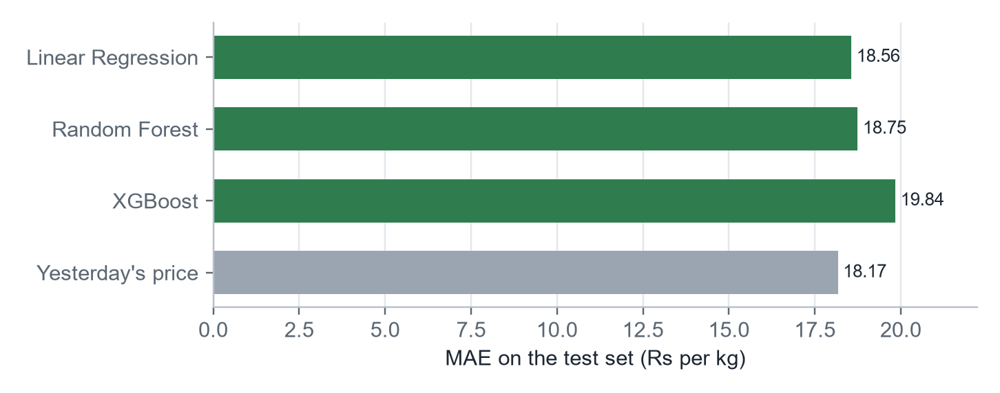

*Figure 6.2: Earlier one-day models compared with yesterday's price (MAE)*

#### 6.7.2 Model selection and feature groups

For the direct forecaster, five models were compared on four consecutive three-month validation windows before the test period (14 May 2025 to 13 May 2026), each trained only on earlier targets (Table 6.5). Ridge Regression was the most accurate or equal-best at every tested horizon while being fast and stable.

**Table 6.5: Validation MAE (Rs/kg) of candidate models**

| Days ahead | Linear | Ridge α=100 | Ridge α=1000 | Random Forest | XGBoost |
|---|---|---|---|---|---|
| 1 | 19.19 | 19.17 | **19.08** | 19.11 | 19.18 |
| 7 | 38.97 | 38.92 | **38.67** | 39.09 | 38.94 |
| 14 | 53.91 | 53.66 | **53.27** | 54.19 | 53.42 |
| 30 | 73.52 | **73.39** | 74.51 | 79.15 | 77.60 |

Removing one feature group at a time showed that prices already published for other markets were by far the most useful information for next-day forecasts (removing them lost 3.81 percentage points of improvement over the baseline), while the current price level mattered most at longer horizons (17.53 points at 30 days). Fuel prices contributed little.

#### 6.7.3 Direct forecaster on the test period

Table 6.6 and Figure 6.3 show the saved forecaster's results on the test period. Its MAE and MAPE are lower than the baseline's at every horizon, and the 95% confidence intervals of the MAE gain are entirely above zero. From 8 days ahead, however, its RMSE is about equal to the baseline's: the model reduces typical errors but not the largest ones, which come from sudden price spikes that neither method foresees.

**Table 6.6: Direct forecaster compared with holding the last price, test period 14 May to 6 November 2026**

| Days ahead | Rows | MAE model | MAE baseline | RMSE model | RMSE baseline | MAPE model | R² model | MAE gain (95% CI) |
|---|---|---|---|---|---|---|---|---|
| 1 | 4,773 | 17.47 | 18.26 | 28.62 | 30.83 | 7.51% | 0.969 | 4.3% (2.6 to 6.0) |
| 2-3 | 9,537 | 23.78 | 25.10 | 39.88 | 42.22 | 9.92% | 0.940 | 5.3% (3.5 to 6.9) |
| 4-7 | 19,029 | 32.13 | 33.53 | 54.12 | 55.42 | 13.01% | 0.889 | 4.2% (2.5 to 5.9) |
| 8-14 | 33,187 | 42.76 | 44.70 | 73.34 | 72.82 | 16.86% | 0.796 | 4.3% (2.0 to 6.4) |
| 15-21 | 33,067 | 53.53 | 57.70 | 93.93 | 93.71 | 20.72% | 0.667 | 7.2% (4.5 to 9.8) |
| 22-30 | 42,374 | 65.66 | 71.20 | 115.01 | 114.33 | 25.10% | 0.502 | 7.8% (4.4 to 11.2) |

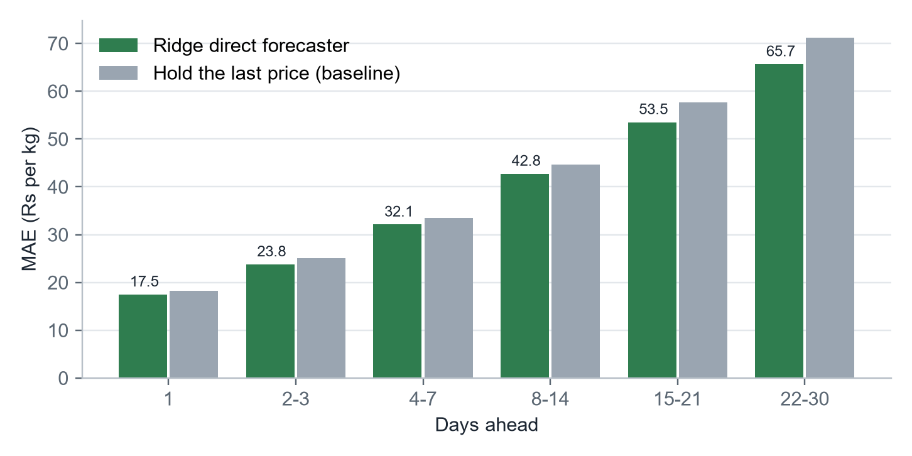

*Figure 6.3: Mean absolute error by forecast range: direct forecaster and baseline (test period)*

On the 3,836 next-day rows that every method can score, the direct forecaster's MAE was 17.56, against 18.63 for the earlier Linear Regression and 18.27 for holding the last price. Compared with recursive forecasting on the same eight vegetables and six start dates, its MAPE at 15-30 days was 25.8% rather than 36.5%, confirming that errors accumulate when predictions are fed back (Ben Taieb et al., 2012).

#### 6.7.4 Results by vegetable

At one day ahead the forecaster beat the baseline for 21 of the 30 vegetables with test data (Figure 6.4). It was worse for nine: Beetroot, Beetroot (Nuwara Eliya), Big Onion (Imported), Big Onion (Local), Brinjal, Drumstick, Ladies Fingers, Lime and Manioc. Several of these are among the least volatile series, whose price often does not change from one reading to the next, so the baseline is already very accurate and any movement the model predicts tends to add error. Imported produce also depends on import arrivals and exchange rates, which are not model inputs.

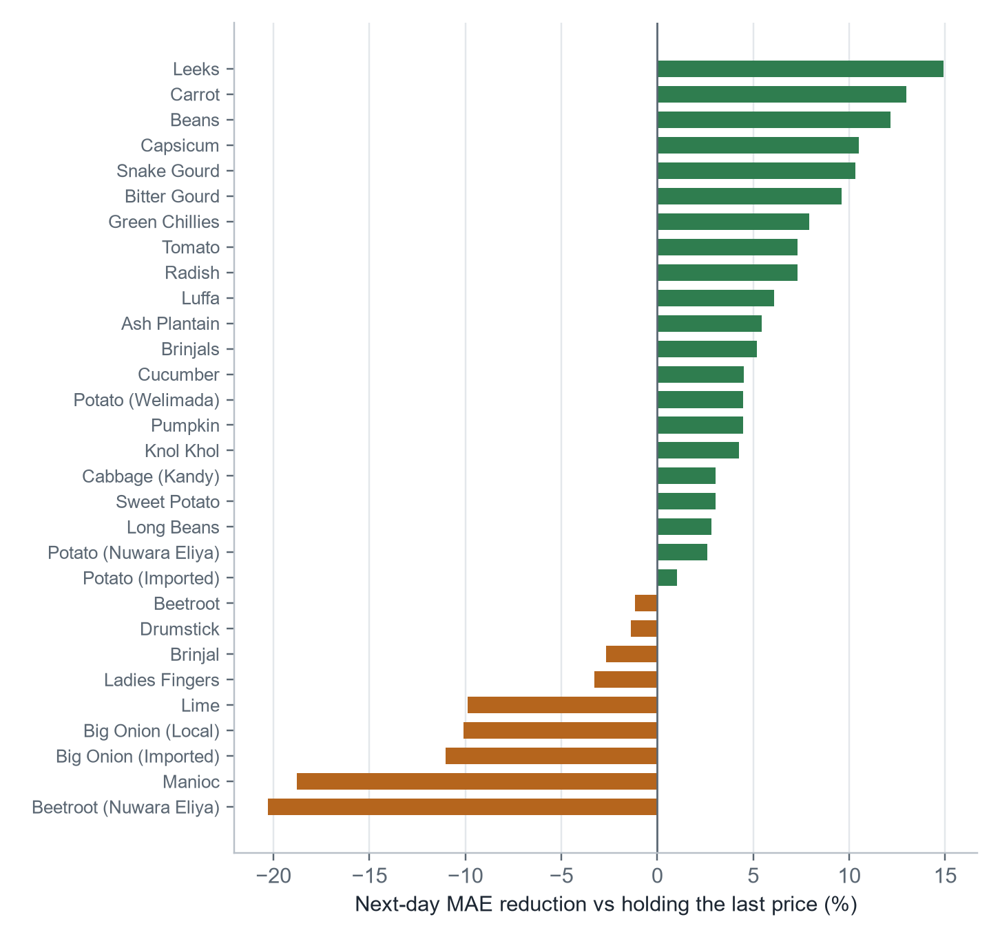

*Figure 6.4: Next-day MAE reduction compared with holding the last price, by vegetable*

#### 6.7.5 Retraining check on the full history

The saved model was trained on data from 25 April 2024 to 6 November 2026. On 13 November 2026, scripts/retrain_if_better.py trained a candidate on the full 2015-2026 history and tested it on the most recent 60 days (14 September to 12 November 2026), which the candidate had not seen. The candidate beat holding the last price at short horizons (4.3% at one day ahead, 95% interval 1.1 to 7.2) but was worse at 15-21 days (-5.0%) and 22-30 days (-14.8%), and -6.1% overall (interval -9.1 to -3.3). Because the acceptance rule requires a clear gain overall and in every band, the candidate was rejected and the saved model was kept (Table 6.7). A model trained on the shorter 2024-2026 history performed no better on the same window, which suggests that the recent period was harder to forecast at long horizons rather than that the longer history was harmful.

**Table 6.7: Retraining decision of 13 November 2026 (hold-out 14 September to 12 November 2026)**

| Days ahead | Rows | Candidate MAE | Baseline MAE | Gain (95% CI) |
|---|---|---|---|---|
| 1 | 1,666 | 18.36 | 19.19 | 4.3% (1.1 to 7.2) |
| 2-3 | 3,326 | 24.79 | 26.56 | 6.7% (4.0 to 9.3) |
| 4-7 | 6,638 | 32.72 | 34.69 | 5.7% (2.8 to 8.2) |
| 8-14 | 11,599 | 45.60 | 46.33 | 1.6% (-2.8 to 5.1) |
| 15-21 | 11,590 | 61.24 | 58.31 | -5.0% (-9.6 to -1.0) |
| 22-30 | 14,822 | 79.84 | 69.57 | -14.8% (-17.8 to -11.8) |

### 6.8 Discussion

The results answer the main question honestly. Official PDF bulletins can be turned into an accurate daily dataset automatically, and independent checks of the 2024-2026 data found no extraction errors. A naive forecast is very hard to beat for daily vegetable prices: the earlier models looked excellent by R² but added nothing over yesterday's price. Predicting the change in price, with one model per horizon and features built only from published information, gives a real but modest improvement of about 4% at one day and 7 to 8% at three to four weeks on the test period. Prices published for other markets were the most valuable short-term information, which suggests that price changes spread between markets over a few days.

The retraining check is an important caution. On the most recent 60 days a model of the same design did not beat the baseline at long horizons, so the long-horizon gains measured on May-November 2026 may not hold in every period. The application therefore shows the measured error with each forecast, and the planner labels history and seasonal references for what they are.

The comparison with published studies must be made carefully. Navaratnalingam, Kodagoda and Suriyawansa (2020) reported an average RMSE of Rs 19.46/kg for Pettah and Dambulla, while this project's next-day RMSE is Rs 28.62 at Dambulla. These numbers are not comparable: the studies used different vegetables, periods and horizons, and 2026 prices are much higher than in the years those studies covered (Figure 5.2).

## 7. Conclusion and Future Work

### 7.1 Project Achievements

The project produced a working, locally run web application backed by a tested data pipeline. It reads eleven years of official HARTI bulletins and keeps HARTI, CBSL, DCS, weather and fuel data current automatically, with validation, backups and visible freshness. A direct multi-horizon Ridge forecaster provides Dambulla wholesale forecasts up to 30 days ahead with a measured improvement over the naive baseline. The cultivation planner turns published DOA/HORDI harvest durations into harvest windows and compares the current price with the expected harvest-time price, and the entire interface is available in English, Sinhala and Tamil. All 1,320 automated tests and the browser tests pass.

### 7.2 Objectives Achievement Review

**Table 7.1: Achievement of the objectives in Section 1.5**

| Objective | Result | Status |
|---|---|---|
| 1. Official prices with provenance | HARTI 2015-2026 (11 markets), CBSL and DCS datasets with source URLs, hashes and a manifest | Achieved |
| 2. Weather and fuel | Regional Open-Meteo weather and CEYPETCO fuel merged by date | Achieved |
| 3. Leakage-free features | As-of-origin features; leakage tests pass | Achieved |
| 4. Models and baseline evaluation | Five model types compared on validation; test results with bootstrap intervals; 4-8% MAE reduction | Achieved |
| 5. Streamlit dashboard | Five pages | Achieved |
| 6. Cultivation planner | 77 published timings; harvest windows; current vs harvest-time price | Achieved (no cost, yield or profit estimates) |
| 7. Automatic updates | Every 3 hours with validation, retries, lock recovery, manifest and freshness | Achieved |
| 8. Three languages | 864 texts in Sinhala and Tamil; switcher with persistence | Achieved (translations not yet reviewed by a native speaker) |
| 9. Testing | 1,320 automated tests and 30 browser tests passed | Achieved |

### 7.3 Limitations

- **Not real-time.** The system is as current as the latest official bulletin, which is usually one to three days old for HARTI.
- **One forecast market.** Forecasts are made only for Dambulla.
- **Modest and period-dependent gains.** The improvement over the baseline is 4 to 8% on the test period; sudden spikes are not predicted, nine vegetables are forecast less accurately than the baseline at one day ahead, and the retraining check found no long-horizon gain on the most recent 60 days.
- **Model not retrained on the full history.** The retraining candidate was rejected, so the saved model uses 2024-2026 data.
- **Incomplete history.** 224 bulletins could not be read, mostly from 2022 and 2023.
- **Planner scope.** Harvest timing is published guidance, not a prediction, and there are no cost, yield, revenue or profit calculations.
- **Translations.** The Sinhala and Tamil wording was written for this project and has not yet been reviewed by native speakers, particularly the agricultural terms. A few explanatory texts on the Home page still describe the earlier synthetic sample option, which is no longer offered on the Predict page.
- **Local application.** There is no online deployment, user accounts or access control, and no testing with real farmers or traders.

### 7.4 Future Enhancements

1. Review the Sinhala and Tamil translations with native speakers and agricultural officers.
2. Evaluate forecasts with farmers and traders, and collect feedback on which horizons and presentations help most.
3. Add a reader for the 2022-2023 one-page bulletin layout to fill the largest gap in the history.
4. Warn users, or stop offering forecasts, for vegetable and horizon combinations where the model is worse than the baseline, and re-run the retraining check as new data arrives.
5. Extend forecasts to other markets such as Peliyagoda, Keppetipola and Meegoda.
6. Explore inputs that might anticipate spikes, such as rainfall forecasts for growing areas, and compare LSTM or gradient-boosted models under the same evaluation.
7. Deploy the application to a server with authentication and run the updates there.

### 7.5 Final Conclusion

The project shows that a reliable vegetable price forecasting and planning tool for Sri Lanka can be built entirely from official public data, provided that the data is extracted carefully and the forecasts are judged honestly. The final forecaster offers a modest but measured improvement over assuming that prices will not change, and the application makes the source, age and uncertainty of every number clear in three languages. The data pipeline, tests and evaluation method provide a sound base for the improvements listed above.

## References

Artifex Software (2026) *PyMuPDF documentation*. Available at: https://pymupdf.readthedocs.io (Accessed: 17 November 2026).  
Ben Taieb, S., Bontempi, G., Atiya, A.F. and Sorjamaa, A. (2012) 'A review and comparison of strategies for multi-step ahead time series forecasting based on the NN5 forecasting competition', *Expert Systems with Applications*, 39(8), pp. 7067-7083. doi:10.1016/j.eswa.2012.01.039.  
Bergmeir, C. and Benítez, J.M. (2012) 'On the use of cross-validation for time series predictor evaluation', *Information Sciences*, 191, pp. 192-213. doi:10.1016/j.ins.2011.12.028.  
Box, G.E.P., Jenkins, G.M., Reinsel, G.C. and Ljung, G.M. (2015) *Time Series Analysis: Forecasting and Control*. 5th edn. Hoboken, NJ: Wiley.  
Breiman, L. (2001) 'Random forests', *Machine Learning*, 45(1), pp. 5-32. doi:10.1023/A:1010933404324.  
CBSL (2026) *Daily Price Report*. Central Bank of Sri Lanka. Available at: https://www.cbsl.gov.lk/en/statistics/economic-indicators/price-report (Accessed: 17 November 2026).  
Chen, T. and Guestrin, C. (2016) 'XGBoost: a scalable tree boosting system', in *Proceedings of the 22nd ACM SIGKDD International Conference on Knowledge Discovery and Data Mining*. San Francisco, CA, pp. 785-794. doi:10.1145/2939672.2939785.  
DCS (2026) *Retail prices*. Department of Census and Statistics, Sri Lanka. Available at: https://www.statistics.gov.lk/InflationAndPrices/StaticalInformation/RetailPrices (Accessed: 17 November 2026).  
Deshan, K. (2026) *AI-Powered Sri Lankan Vegetable Price Prediction System: interim report*. CS6P05ES Project, unpublished.  
DOA (2026) *HORDI crops*. Department of Agriculture, Sri Lanka. Available at: https://doa.gov.lk/hordi-crops/ (Accessed: 9 November 2026).  
Efron, B. and Tibshirani, R.J. (1993) *An Introduction to the Bootstrap*. New York: Chapman & Hall.  
Ezekiel, M. (1938) 'The cobweb theorem', *The Quarterly Journal of Economics*, 52(2), pp. 255-280. doi:10.2307/1881734.  
FAO (2026) *Global Information and Early Warning System (GIEWS)*. Food and Agriculture Organization of the United Nations. Available at: https://www.fao.org/giews/en/ (Accessed: 18 November 2026).  
Fonseka, D.D. and Karunasena, A. (2022) 'Comparison of ARIMA and LSTM in forecasting the retail prices of vegetables in Colombo, Sri Lanka', in *Proceedings of the 4th International Conference on Advancements in Computing (ICAC)*. Colombo, pp. 66-71. doi:10.1109/ICAC57685.2022.10025072.  
Harris, C.R. *et al.* (2020) 'Array programming with NumPy', *Nature*, 585, pp. 357-362. doi:10.1038/s41586-020-2649-2.  
HARTI (2026) *Daily food commodities bulletin*. Hector Kobbekaduwa Agrarian Research and Training Institute. Available at: https://www.harti.gov.lk/daily-price.php (Accessed: 17 November 2026).  
Hastie, T., Tibshirani, R. and Friedman, J. (2009) *The Elements of Statistical Learning: Data Mining, Inference, and Prediction*. 2nd edn. New York: Springer.  
Hathurusingha, C., Abdelhamid, N. and Airehrour, D. (2019) 'Forecasting models based on data analytics for predicting rice price volatility: a case study of the Sri Lankan rice market', *Journal of Information & Knowledge Management*, 18(1), 1950006. doi:10.1142/S0219649219500060.  
Hersbach, H. *et al.* (2020) 'The ERA5 global reanalysis', *Quarterly Journal of the Royal Meteorological Society*, 146(730), pp. 1999-2049. doi:10.1002/qj.3803.  
Hoerl, A.E. and Kennard, R.W. (1970) 'Ridge regression: biased estimation for nonorthogonal problems', *Technometrics*, 12(1), pp. 55-67. doi:10.1080/00401706.1970.10488634.  
Hyndman, R.J. and Athanasopoulos, G. (2021) *Forecasting: Principles and Practice*. 3rd edn. Melbourne: OTexts. Available at: https://otexts.com/fpp3/ (Accessed: 11 November 2026).  
Hyndman, R.J. and Koehler, A.B. (2006) 'Another look at measures of forecast accuracy', *International Journal of Forecasting*, 22(4), pp. 679-688. doi:10.1016/j.ijforecast.2006.03.001.  
Makridakis, S., Spiliotis, E. and Assimakopoulos, V. (2018) 'Statistical and machine learning forecasting methods: concerns and ways forward', *PLoS ONE*, 13(3), e0194889. doi:10.1371/journal.pone.0194889.  
McKinney, W. (2010) 'Data structures for statistical computing in Python', in *Proceedings of the 9th Python in Science Conference (SciPy)*. Austin, TX, pp. 56-61.  
Navaratnalingam, S., Kodagoda, N. and Suriyawansa, K. (2020) 'Exploiting multivariate LSTM models with multistep price forecasting for agricultural produce in Sri Lankan context', in *Proceedings of the 2nd International Conference on Advancements in Computing (ICAC)*. Sri Lanka, pp. 328-332. doi:10.1109/ICAC51239.2020.9357144.  
Pedregosa, F. *et al.* (2011) 'Scikit-learn: machine learning in Python', *Journal of Machine Learning Research*, 12, pp. 2825-2830.  
Ranaweera, H.M.B.P., Rathnayake, R.M.G.H.N. and Ananda, A.S.G.J.K. (2023) 'Crop price prediction using machine learning approaches: reference to the Sri Lankan vegetable market', *Journal of Management Matters*, 10(1), pp. 19-34. doi:10.4038/jmm.v10i1.45.  
Streamlit Inc. (2026) *Streamlit documentation*. Available at: https://docs.streamlit.io (Accessed: 17 November 2026).  
Tran, N.-Q. *et al.* (2023) 'Predicting agricultural commodities prices with machine learning: a review of current research', arXiv preprint arXiv:2310.18646.  
Weerasekara, R. *et al.* (2026) 'When prices double in a week: forecasting of agricultural volatility in import-isolated markets', arXiv preprint arXiv:2606.29248.  
WFP (2026) *Sri Lanka - food prices*. World Food Programme, Humanitarian Data Exchange. Available at: https://data.humdata.org/dataset/wfp-food-prices-for-sri-lanka (Accessed: 9 November 2026).  
Zelingher, R. (2024) 'Democratising agricultural commodity price forecasting: the AGRICAF approach', arXiv preprint arXiv:2410.20363.  
Zippenfenig, P. (2023) *Open-Meteo.com Weather API*. Zenodo. doi:10.5281/zenodo.7970649.  

## Appendix A: Detailed Test Cases

### A.1 Test environment

**Table A.1: Test environment**

| Item | Value |
|---|---|
| Computer | AMD Ryzen 5 5500, 16 GB RAM, Windows 11 Pro |
| Python | 3.12.10 in .venv312; packages as pinned in requirements.txt |
| Automated tests | pytest, run on 17 November 2026: python -m pytest (JUnit XML kept in test_evidence/) |
| Browser tests | Script driving headless Microsoft Edge against http://localhost:8501, run on 2026-11-18 (results in test_evidence/browser_tests.json) |
| Data | Datasets updated to 17 November 2026; saved forecaster trained through 6 November 2026 |

Status is Pass, Fail or Blocked. An automated test case passes only if its pytest test passed in the full run; a test with several parameter cases passes only if all of them passed. A browser test passes only if the page showed the expected result.

### A.2 Automated test cases

**Table A.2: Automated test cases (pytest; actual results from the run of 17 November 2026)**

| ID | Feature | Preconditions | Steps | Expected result | Actual result | Status | Evidence |
|---|---|---|---|---|---|---|---|
| AT-01 | Startup | Saved model and datasets present | Run Home in AppTest with the real files | Home describes the ready Ridge forecaster and its training date; no error | Passed: 1 of 1 case(s), 0.65 s | Pass | app/test_model_availability.py::test_home_describes_the_ready_forecaster |
| AT-02 | Startup | Required files removed in a temporary copy | Check model availability | Each missing file is named individually; no crash | Passed: 3 of 3 case(s), 0.06 s | Pass | app/test_model_availability.py::test_each_missing_file_is_named |
| AT-03 | Navigation | Home opened in Sinhala | Switch to the Cultivation Planner page | Planner opens; language stays Sinhala | Passed: 1 of 1 case(s), 0.91 s | Pass | app/test_i18n.py::test_the_language_survives_page_navigation |
| AT-04 | Prediction | Real datasets present | Open Predict | Two data sources offered; Latest Real Data Prediction selected by default | Passed: 1 of 1 case(s), 1.38 s | Pass | app/test_predict_page_forecast_ui.py::test_only_two_data_sources_and_real_data_is_the_default |
| AT-05 | Prediction | Real datasets present | Read the forecast period options | Options are 1, 7, 14 and 30 days plus a date up to 30 days | Passed: 1 of 1 case(s), 1.13 s | Pass | app/test_predict_page_forecast_ui.py::test_forecast_periods_are_1_7_14_and_30_days |
| AT-06 | Prediction | Saved forecaster | Predict Beans on the page and directly with the forecaster | Page value equals the forecaster's output; starting record named | Passed: 1 of 1 case(s), 12.92 s | Pass | app/test_predict_page_forecast_ui.py::test_beans_forecast_equals_the_saved_forecaster_and_names_its_starting_point |
| AT-07 | Prediction | Real datasets | List vegetables offered for prediction | Stale or untrained series are excluded, each with a reason | Passed: 1 of 1 case(s), 0.18 s | Pass | app/test_catalogue.py::test_stale_and_untrained_series_are_not_offered_for_prediction |
| AT-08 | Prediction | Small trained forecaster | Request an unknown vegetable and a series with no price | A clear error, never a made-up forecast | Passed: 1 of 1 case(s), 0.07 s | Pass | models/test_direct_forecaster.py::test_forecast_refuses_an_unknown_vegetable_and_a_missing_price |
| AT-09 | Prediction (input validation) | Upload without a price column | Load the upload | Message names the missing column and lists the columns found | Passed: 1 of 1 case(s), 0.00 s | Pass | app/test_model_availability.py::test_a_missing_column_message_lists_what_was_found |
| AT-10 | Prediction (input validation) | Upload with duplicate rows | Load the upload | Exact duplicates dropped and reported | Passed: 1 of 1 case(s), 0.01 s | Pass | app/test_model_availability.py::test_exact_duplicate_upload_rows_are_dropped_and_reported |
| AT-11 | Prediction | None | Check past, current and future target dates | Only past dates are flagged as already passed | Passed: 1 of 1 case(s), 0.00 s | Pass | app/test_catalogue.py::test_a_past_target_date_is_flagged_and_today_or_later_is_not |
| AT-12 | Price history | Real datasets | Inspect harti_all_markets.csv | Each market is a separate series; no mixing | Passed: 1 of 1 case(s), 1.08 s | Pass | data_collection/test_dataset_integrity.py::test_every_market_is_its_own_series |
| AT-13 | Price history | Real datasets | Inspect the CBSL and HARTI files | Retail prices are never stored with wholesale prices | Passed: 1 of 1 case(s), 0.14 s | Pass | data_collection/test_dataset_integrity.py::test_retail_prices_are_a_separate_dataset |
| AT-14 | Price history (charts) | Series with a long gap | Build the chart series | The line breaks only across gaps longer than 7 days | Passed: 1 of 1 case(s), 0.75 s | Pass | app/test_model_availability.py::test_chart_line_breaks_only_across_long_gaps |
| AT-15 | Planner (harvest date) | 77 published timings | Compute every harvest window for 5 difficult start dates | Identical to an independent standard-library calculation | Passed: 385 of 385 case(s), 0.81 s | Pass | app/test_cultivation.py::test_every_crop_and_variety_window_matches_an_independent_calculation |
| AT-16 | Planner (duration) | None | Add month durations across month ends and leap years | Calendar months are used; no month is 30 days by assumption | Passed: 1 of 1 case(s), 0.01 s | Pass | app/test_cultivation.py::test_no_month_is_treated_as_30_days |
| AT-17 | Planner (source) | Saved DOA pages | Compare each quoted sentence with the saved page | Every quote appears on its DOA/HORDI page | Passed: 1 of 1 case(s), 0.15 s | Pass | app/test_cultivation.py::test_source_wording_matches_the_saved_official_pages |
| AT-18 | Planner (prices) | Real data, saved model | Generate a plan with a harvest within reach | Current price, forecast and difference match the data and model | Passed: 1 of 1 case(s), 8.17 s | Pass | app/test_cultivation_planner_page.py::test_both_prices_and_their_difference_come_from_the_real_data_and_model |
| AT-19 | Planner (prices) | Real data | Generate a plan with a distant harvest | Comparison uses a seasonal reference labelled 'not a forecast' | Passed: 1 of 1 case(s), 1.41 s | Pass | app/test_cultivation_planner_page.py::test_a_long_harvest_compares_with_a_labelled_seasonal_reference |
| AT-20 | Planner (missing price) | Crop without a HARTI series | Build the plan | Harvest dates only; an explanation instead of a price | Passed: 1 of 1 case(s), 0.00 s | Pass | app/test_cultivation.py::test_a_crop_with_no_price_series_gets_an_explanation_not_a_price |
| AT-21 | Planner (missing price) | Sparse history | Build a distant plan | Falls back to the latest actual price, labelled as not a prediction | Passed: 1 of 1 case(s), 0.04 s | Pass | app/test_cultivation.py::test_too_few_seasonal_prices_fall_back_to_the_latest_actual_price |
| AT-22 | Planner (prices) | Stale series | Generate a plan | An old price is not compared as today's price | Passed: 1 of 1 case(s), 1.55 s | Pass | app/test_cultivation_planner_page.py::test_a_stale_price_is_not_compared_as_todays_price |
| AT-23 | Updates (download) | Real bulletin fixture; temporary folder | Run the daily update | New rows added; stored rows unchanged; backup made | Passed: 1 of 1 case(s), 6.07 s | Pass | scripts/test_daily_update.py::test_new_bulletin_is_added_and_stored_rows_are_untouched |
| AT-24 | Updates (duplicates) | Temporary folder | Run the update twice | The second run adds nothing | Passed: 1 of 1 case(s), 6.50 s | Pass | scripts/test_daily_update.py::test_running_twice_adds_nothing_the_second_time |
| AT-25 | Updates (validation) | Rows with impossible values | Validate | Negative prices, low above high and late readings are rejected | Passed: 1 of 1 case(s), 0.00 s | Pass | scripts/test_daily_update.py::test_validation_rejects_impossible_rows |
| AT-26 | Updates (validation) | Unreadable PDF | Run the update | Reported with exit code 2; nothing written | Passed: 1 of 1 case(s), 0.09 s | Pass | scripts/test_daily_update.py::test_an_unreadable_bulletin_is_reported_and_nothing_is_written |
| AT-27 | Updates (recovery) | Lock of a finished process | Start an update | Earlier run logged as interrupted; lock taken over | Passed: 1 of 1 case(s), 0.16 s | Pass | scripts/test_daily_update.py::test_a_lock_left_by_an_interrupted_run_is_taken_over_and_logged |
| AT-28 | Updates (concurrency) | Lock held by a running update | Start a second update | The second update refuses to start | Passed: 1 of 1 case(s), 0.01 s | Pass | scripts/test_daily_update.py::test_only_one_update_runs_at_a_time |
| AT-29 | Updates (retry) | Source fails then answers | Run the update | Source retried and then succeeds | Passed: 1 of 1 case(s), 0.03 s | Pass | scripts/test_daily_update.py::test_an_unreachable_source_is_retried_before_it_is_called_failed |
| AT-30 | Updates (availability) | One source down | Run the update | Other sources updated; run marked partial (exit code 4) | Passed: 1 of 1 case(s), 0.04 s | Pass | scripts/test_daily_update.py::test_one_unreachable_source_does_not_stop_the_others |
| AT-31 | Updates (manifest) | Dataset newer than the manifest | Run the update | data_manifest.json rewritten | Passed: 1 of 1 case(s), 0.00 s | Pass | scripts/test_daily_update.py::test_the_manifest_is_rewritten_when_a_dataset_is_newer |
| AT-32 | Updates (manifest) | Real datasets | Compare the manifest with the files | Rows, hashes and dates match | Passed: 1 of 1 case(s), 0.21 s | Pass | data_collection/test_dataset_integrity.py::test_the_manifest_matches_the_files |
| AT-33 | Data freshness | Failed check in the log | Compute freshness | Source shown as unavailable; stored data kept | Passed: 1 of 1 case(s), 0.05 s | Pass | app/test_data_freshness.py::test_a_failed_check_is_source_unavailable_and_keeps_the_stored_data |
| AT-34 | Data freshness | Real data | Run all five pages | Each page shows the data freshness panel | Passed: 4 of 4 case(s), 4.52 s | Pass | app/test_data_freshness.py::test_every_page_shows_data_freshness |
| AT-35 | Updates (on request) | None | Interpret each update exit code | A distinct, accurate message for every outcome | Passed: 5 of 5 case(s), 0.01 s | Pass | app/test_data_refresh.py::test_each_exit_code_has_an_honest_message |
| AT-36 | Source parsing (CBSL) | CBSL report of 9 Nov 2026 | Parse the report | Values equal the printed table | Passed: 11 of 11 case(s), 1.05 s | Pass | data_collection/test_cbsl_price_report_parser.py::test_todays_prices_match_the_printed_table |
| AT-37 | Source parsing (HARTI) | HARTI bulletin of 22 Jun 2015 | Parse the bulletin | 2015 layout read correctly, including merged label rows | Passed: 1 of 1 case(s), 2.20 s | Pass | data_collection/test_official_bulletin_parsing.py::test_a_2015_bulletin_reads_the_dambulla_column_including_the_merged_label_rows |
| AT-38 | Multilingual (completeness) | Translation files | Compare the keys of en, si and ta | Identical key sets (over 800 texts) | Passed: 1 of 1 case(s), 0.00 s | Pass | app/test_i18n.py::test_the_three_files_have_exactly_the_same_texts |
| AT-39 | Multilingual (completeness) | Translation files | Check every Sinhala and Tamil entry | Present, in the right script, same placeholders | Passed: 2 of 2 case(s), 0.01 s | Pass | app/test_i18n.py::test_every_translation_is_present_and_keeps_its_placeholders |
| AT-40 | Multilingual (coverage) | Source code | Collect every t() text from the code | Every text has a translation; no f-string passed to t() | Passed: 1 of 1 case(s), 0.49 s | Pass | app/test_i18n.py::test_every_text_the_code_translates_has_a_translation |
| AT-41 | Multilingual (missing text) | None | Translate an unknown text in Tamil | English text returned with values filled in | Passed: 1 of 1 case(s), 0.00 s | Pass | app/test_i18n.py::test_a_text_with_no_translation_falls_back_to_english |
| AT-42 | Multilingual (pages) | Real data | Run all five pages in Sinhala and Tamil | No exception; translated headings and freshness panel | Passed: 10 of 10 case(s), 22.89 s | Pass | app/test_i18n.py::test_every_page_runs_in_each_language |
| AT-43 | Multilingual (switching) | Model Performance in English | Choose Tamil, then English, in the switcher | Page follows each choice | Passed: 1 of 1 case(s), 0.97 s | Pass | app/test_i18n.py::test_choosing_a_language_in_the_switcher_applies_it |
| AT-44 | Multilingual (persistence) | ?lang=ta in the address | Run the page twice | Tamil on both runs | Passed: 1 of 1 case(s), 0.55 s | Pass | app/test_i18n.py::test_the_language_comes_from_the_url_and_is_kept_in_the_session |
| AT-45 | Multilingual (data) | Real data | Generate the same plan in three languages | All Rs values identical | Passed: 1 of 1 case(s), 5.65 s | Pass | app/test_i18n.py::test_planner_prices_and_comparison_are_identical_in_every_language |
| AT-46 | Model (loading) | Trained forecaster | Save, reload and predict | Same predictions after reloading | Passed: 1 of 1 case(s), 0.14 s | Pass | models/test_direct_forecaster.py::test_forecaster_survives_saving_and_loading |
| AT-47 | Model (leakage) | Feature builder | Change all data after a date | No feature on or before that date changes | Passed: 4 of 4 case(s), 1.24 s | Pass | feature_engineering/test_forecast_features.py::test_changing_any_later_data_moves_no_earlier_feature |
| AT-48 | Model (leakage) | Late-reported market | Build features | A reading is used only after its bulletin was published | Passed: 1 of 1 case(s), 0.67 s | Pass | feature_engineering/test_forecast_features.py::test_an_other_market_reading_is_unknown_before_its_bulletin_is_published |
| AT-49 | Model (training) | Training rows across the test start | Fit with target_before | No test-period target enters training | Passed: 1 of 1 case(s), 0.22 s | Pass | models/test_direct_forecaster.py::test_target_before_excludes_later_targets_from_training |
| AT-50 | Model (metrics) | Known values | Score predictions | MAE, RMSE and MAPE equal a hand calculation | Passed: 1 of 1 case(s), 0.00 s | Pass | models/test_direct_forecaster.py::test_score_predictions_matches_a_hand_calculation |
| AT-51 | Model (validation split) | Dated rows | Split chronologically | Oldest rows train, newest rows test | Passed: 1 of 1 case(s), 0.02 s | Pass | feature_engineering/test_train_test_split.py::test_oldest_rows_go_to_train_and_newest_to_test |
| AT-52 | Model (consistency) | Saved forecaster | Compare planner and forecaster | The planner's price is exactly the forecaster's output | Passed: 1 of 1 case(s), 4.58 s | Pass | app/test_cultivation.py::test_planned_harvest_price_is_the_trained_forecasters_output |

### A.3 Browser test cases

**Table A.3: Browser test cases on the running application (headless Edge)**

| ID | Feature | Preconditions | Steps | Expected result | Actual result | Status | Evidence |
|---|---|---|---|---|---|---|---|
| BT-01 | Startup and navigation | App running; data to 17 Nov 2026 | Open http://localhost:8501 | Page loads with no error box; shows model summary, data freshness and the datasets in use | Loaded: True; exception boxes: 0; 'Data freshness' shown: True; 'Datasets' shown: True | Pass | home_en.png |
| BT-02 | Data freshness | App running; data to 17 Nov 2026 | Open Home; read the Data freshness panel | Each source (HARTI, CBSL, DCS, weather, fuel) has a latest-data date and a status | Data freshness HARTI daily bulletin Recently Updated Type: Wholesale Location: Dambulla (used by the model) and 10 other markets Latest data: 2026-11-17 Last successful sync: 2026-11-17 22:00 Publishes: Daily bulletins, uploaded 1-3 days after the market day New data was added in the last 24 hours. CBSL Daily Price Report Latest | Pass | home_en.png |
| BT-03 | Automatic updates | App running; data to 17 Nov 2026 | Open Home; read the update line and the retraining note | The time of the last update run and the newest HARTI bulletin are shown; the latest retraining decision is stated | Last daily update 2026-11-17 22:00; newest HARTI bulletin listed 2026-11-17; 0 Dambulla and 0 all-market prices added. Updates import newly published official b / Last retraining check 2026-11-13: rejected; the saved model was kept. Held-out prices 2026-09-14 to 2026-11-12: the candidate's MAE was 6.1% higher than holding the la | Pass | home_en.png |
| BT-04 | Startup and navigation | App running; data to 17 Nov 2026 | Open Predict, Model Performance, Price History and Cultivation Planner in turn | Each page shows its first section; no error boxes | Predict: loaded, errors 0; Model_Performance: loaded, errors 0; Price_History: loaded, errors 0; Cultivation_Planner: loaded, errors 0 | Pass | - |
| BT-05 | Prediction | App running; data to 17 Nov 2026 | Open Predict | Data source 'Latest Real Data Prediction' selected; HARTI, CBSL and DCS status shown | 1. Official source status  HARTI Daily wholesale bulletin, every market  Checked successfully  Newest publication found: 2026-11-17 (1 day(s) ago) Last checked: 2026-11-17 22:00 New data collected: none, nothing newer was published  CBSL Daily Price Report, wholesale and retail  Checked successfully  Newest publication found: 20 | Pass | predict_default.png |
| BT-06 | Prediction | App running; data to 17 Nov 2026 | Select Beans; choose '7 days'; click Predict | A price in Rs/kg for the date 7 days after the latest HARTI price, a chart, and the 1/7/14/30-day table with measured errors | Forecast date 2026-11-24: 7 day(s) after the latest actual price (2026-11-17); forecast shown: Rs. 463.04 / kg for 2026-11-24 (latest actual Rs. 450.00 / kg on 2026-11-17); horizon table shown: True; error boxes: 0 | Pass | predict_result_beans_7d.png |
| BT-07 | Prediction | App running; data to 17 Nov 2026 | As BT-06; read the caption under the forecast period | The caption states the target date and the number of days after the latest actual price | Forecast date 2026-11-24: 7 day(s) after the latest actual price (2026-11-17) | Pass | predict_result_beans_7d.png |
| BT-08 | Prediction | App running; data to 17 Nov 2026 | Inspect the forecast period options | Only 1, 7, 14, 30 days or another date up to 30 days are offered; the date picker stops at 30 days after the latest price | Options: 1 day / 7 days / 14 days / 30 days / 'Another date (up to 30 days)' present: True (date limits set by min_value/max_value in 1_Predict.py) | Pass | predict_result_beans_7d.png |
| BT-09 | Prediction / input validation | App running; data to 17 Nov 2026 | Choose 'Upload CSV'; upload missing_price_column.csv | A clear error names the missing column; no prediction is made | Message: 'The CSV is missing required column(s): ['price']. Columns found: ['date', 'vegetable', 'market', 'source', 'rainfall_mm', 'temperature_c', 'humidity_pct']. Headers must be lowercase, and values separated by commas.' | Pass | predict_upload_missing_price_column.png |
| BT-10 | Prediction / input validation | App running; data to 17 Nov 2026 | Choose 'Upload CSV'; upload empty.csv | A clear error says the file is empty | Message: 'That file is empty. It needs a header row and at least one row of data.' | Pass | predict_upload_empty.png |
| BT-11 | Model performance | App running; data to 17 Nov 2026 | Open Model Performance | Error by forecast range for the model and for holding the last price; next-day MAE Rs 17.47 | Loaded: True; 'Hold last price' present: True; '17.47' present: True | Pass | performance_en.png |
| BT-12 | Price history | App running; data to 17 Nov 2026 | Open Price History (HARTI source, default vegetable, Dambulla) | Chart, latest/average/lowest/highest cards and weather chart are shown | Heading: 'Ash Plantain wholesale price at Dambulla'; cards shown: True; weather section: True | Pass | history_harti_dambulla.png |
| BT-13 | Price history | App running; data to 17 Nov 2026 | Select market Kandy | The chart and cards switch to Kandy | Heading: 'Ash Plantain wholesale price at Kandy' | Pass | history_harti_kandy.png |
| BT-14 | Price history | App running; data to 17 Nov 2026 | Choose 'CBSL daily report'; choose 'retail' | One chart of retail prices for Pettah, Dambulla and Narahenpita; no wholesale values mixed in | Heading: 'Beans: retail price, CBSL'; Narahenpita present: True | Pass | history_cbsl_retail.png |
| BT-15 | Price history | App running; data to 17 Nov 2026 | Choose 'DCS weekly retail' | Weekly retail chart with a years filter and summary cards | Heading: 'Ash Plantain: retail price, Colombo District'; years filter: True | Pass | history_dcs.png |
| BT-16 | Price history | App running; data to 17 Nov 2026 | Open Price History; read the date range field | A start and end date are shown and can be changed | Date range field value: '2015-06-22 / 2026-11-17' | Pass | history_harti_dambulla.png |
| BT-17 | Cultivation planner | App running; data to 17 Nov 2026 | Open Cultivation Planner (Beans, default variety) | The published duration, its quote and source link are shown with the start-date field | Loaded: True; 'Published timing: 45 days to first harvest, counted from planting date.'; quoted text: 'Bush types can be harvested from 45 days after planting'; 'All published durations' panel: True | Pass | planner_input.png |
| BT-18 | Cultivation planner | App running; data to 17 Nov 2026 | Beans (default variety); planting date 10 Oct 2026; Generate Cultivation Plan | Harvest window computed from the published duration (calendar arithmetic) | Expected harvest: 24 Nov 2026 Horizon: 7 days after the latest recorded price (6 days from today) | Pass | planner_within_reach.png |
| BT-19 | Cultivation planner | App running; data to 17 Nov 2026 | As BT-18; read section 3 | Current HARTI Dambulla price with its date, a model forecast for the harvest with a likely range, and the direction of change | Current market price (planning time) Rs. 450.00 / kg Vegetable: Beans Price date: 17 Nov 2026 (1 day(s) ago), latest recorded Day's range: Rs. 400.00  // Expected price at harvest Rs. 463.04 / kg Vegetable: Beans Expected harvest: 24 Nov 2026 Horizon: 7 days after the latest recorded price (6 days from  // The forecast price at | Pass | planner_within_reach.png |
| BT-20 | Cultivation planner | App running; data to 17 Nov 2026 | Planting date 2026-11-18 (today); Generate | No model forecast; the median price in the same weeks of earlier years, labelled 'not a forecast' | Typical price at harvest time Rs. 387.50 / kg Vegetable: Beans Expected harvest: 2 Jan 2027 Horizon: 46 days after the latest recorded price (45 days from today): beyond the model's 30-day forecast Ba / label: 'same weeks of earlier years: history, not a forecast' | Pass | planner_beyond_reach.png |
| BT-21 | Cultivation planner | App running; data to 17 Nov 2026 | Choose Cauliflower; Generate | Harvest dates are shown; the price section says no verified price is available | No verified price | Pass | planner_no_price.png |
| BT-30 | Multilingual | App running; data to 17 Nov 2026 | Open http://localhost:8501/?lang=si | Headings, freshness panel and sidebar are in the chosen language; numbers and dates unchanged | Loaded: True; translated headings found: True; exception boxes: 0; sidebar: '🏠\n\nමුල් පිටුව\n\n📈\n\nපුරෝකථනය\n\n📊\n\nආකෘති කාර්ය සාධනය\n\n🗓️\n\nමිල ඉතිහාසය\n\n🌱\n\nවගා සැලසුම්කරු\n\nදත්ත මූලාශ්\u200dර\nHARTI දෛනික මිල වාර්' | Pass | home_si.png |
| BT-31 | Multilingual | App running; data to 17 Nov 2026 | Open http://localhost:8501/?lang=ta | Headings, freshness panel and sidebar are in the chosen language; numbers and dates unchanged | Loaded: True; translated headings found: True; exception boxes: 0; sidebar: '🏠\n\nமுகப்பு\n\n📈\n\nகணிப்பு\n\n📊\n\nமாதிரி செயல்திறன்\n\n🗓️\n\nவிலை வரலாறு\n\n🌱\n\nபயிர்ச்செய்கைத் திட்டமிடல்\n\nதரவு மூலங்கள்\nHARTI தினசரி' | Pass | home_ta.png |
| BT-32 | Multilingual | App running; data to 17 Nov 2026 | On Home (English) click 'සිංහල' in the switcher at the top right | The page redraws in Sinhala and the address gains ?lang=si | Sinhala headings shown: True; address: http://localhost:8501/?lang=si | Pass | switcher_si.png |
| BT-33 | Multilingual | App running; data to 17 Nov 2026 | After BT-32, open Price History from the sidebar | Price History opens in Sinhala; the address keeps ?lang=si | Address: http://localhost:8501/Price_History?lang=si; Sinhala page title shown: True | Pass | - |
| BT-34 | Multilingual | App running; data to 17 Nov 2026 | On Price History (Sinhala), click 'English' | All headings return to English | English title shown: True; Sinhala title gone: True | Pass | - |
| BT-35 | Multilingual | App running; data to 17 Nov 2026 | Open Price History with ?lang=si | Chart title, axes and cards in the chosen language; dates numeric; prices unchanged | Loaded: True; translated title: True; English month names on chart axes: 0; error boxes: 0 | Pass | history_si.png |
| BT-36 | Multilingual | App running; data to 17 Nov 2026 | Open Price History with ?lang=ta | Chart title, axes and cards in the chosen language; dates numeric; prices unchanged | Loaded: True; translated title: True; English month names on chart axes: 0; error boxes: 0 | Pass | history_ta.png |
| BT-37 | Multilingual | App running; data to 17 Nov 2026 | Repeat BT-18 with ?lang=ta | Every Rs value in the plan matches the English plan | English values: ['Rs. 450.00', 'Rs. 400.00', 'Rs. 440.00', 'Rs. 463.04', 'Rs. 383.54', 'Rs. 13.04']; Tamil values: ['Rs. 450.00', 'Rs. 400.00', 'Rs. 440.00', 'Rs. 463.04', 'Rs. 383.54', 'Rs. 13.04'] | Pass | planner_ta.png |
| BT-38 | Multilingual / layout | App running; data to 17 Nov 2026 | Open /?lang=si at 390 x 844 px | No sideways scrolling; text wraps | Horizontal overflow: 0 px; error boxes: 0 | Pass | home_si_phone.png |

### A.4 Test totals

**Table A.4: Test totals**

| Test type | Executed | Passed | Failed | Blocked | Command or tool |
|---|---|---|---|---|---|
| Automated (full pytest suite) | 1320 | 1320 | 0 | 0 | python -m pytest |
| of which documented above | 52 | 52 | 0 | 0 | Appendix A.2 |
| Browser (scripted, running app) | 30 | 30 | 0 | 0 | headless Microsoft Edge |
| Manual tests with users | 0 | 0 | 0 | 0 | not carried out |

## Appendix B: Additional Screenshots

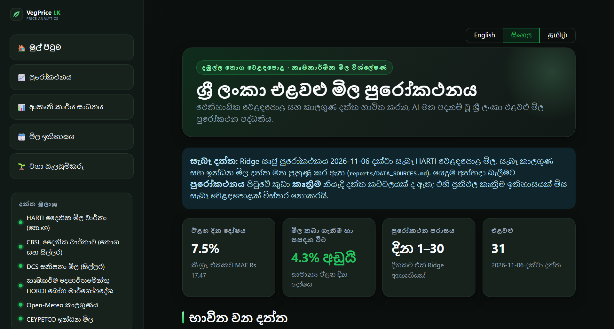

*Figure B.1: Home dashboard in Sinhala*

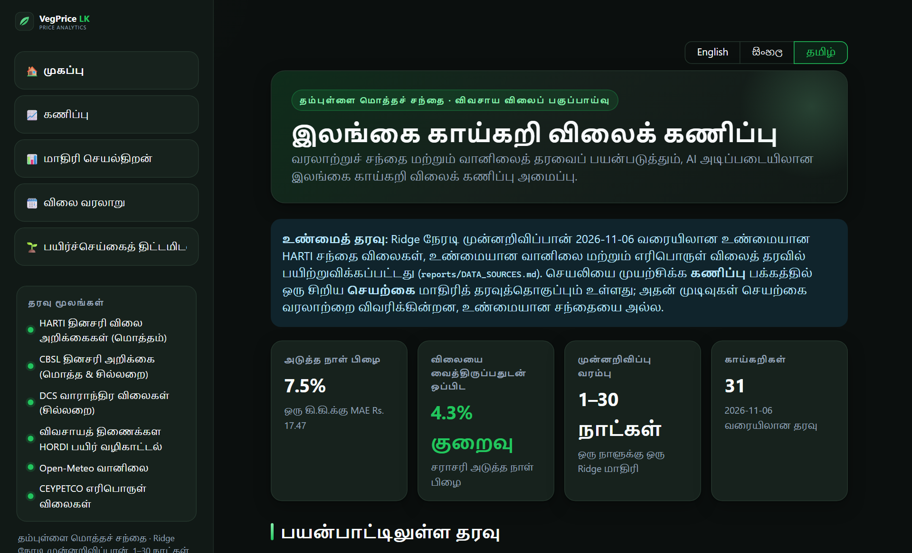

*Figure B.2: Home dashboard in Tamil*

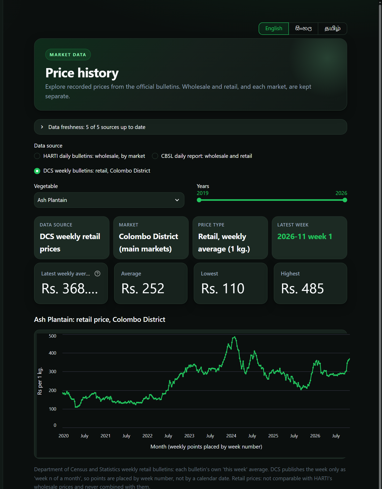

*Figure B.3: Price History: DCS weekly retail prices for Colombo District*

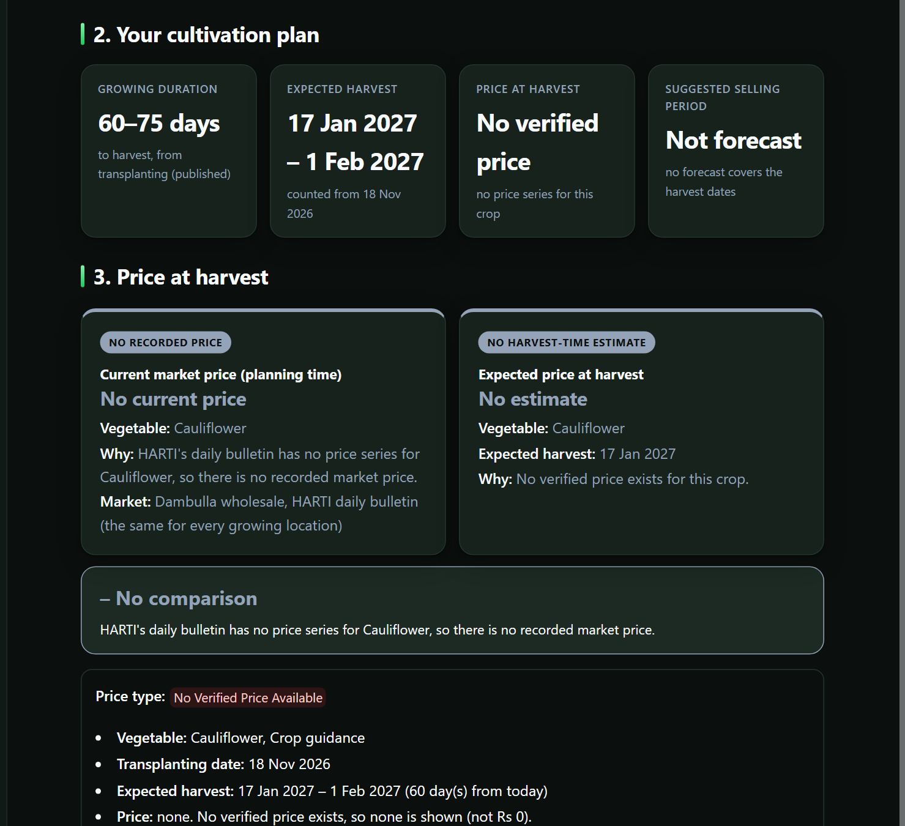

*Figure B.4: Cultivation Planner: a crop without an official price series (cauliflower) receives harvest dates but no price*

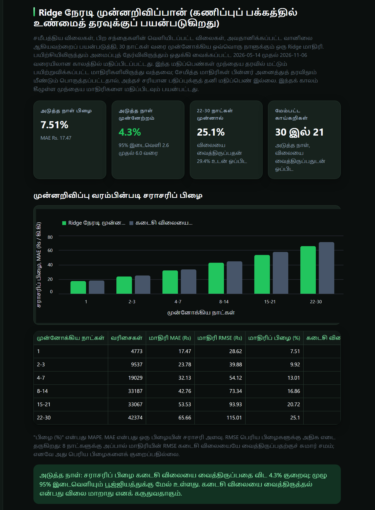

*Figure B.5: Model Performance in Tamil*

## Appendix C: Configuration and Setup Guide

The commands below are run from the project folder in PowerShell.

```
py -3.12 -m venv .venv312
.venv312\Scripts\python.exe -m pip install -r requirements.txt
.venv312\Scripts\python.exe -m pip install -e ".[dev]"
.venv312\Scripts\python.exe -m streamlit run app/Home.py      # or double-click start_app.bat
.venv312\Scripts\python.exe scripts\daily_update.py             # add newly published data now
.venv312\Scripts\python.exe scripts\update_data.py --workers 1  # full rebuild since 2015 (with backup)
.venv312\Scripts\python.exe scripts\train_forecaster.py         # evaluate, then train on all data
.venv312\Scripts\python.exe scripts\retrain_if_better.py        # retrain only if a hold-out check passes
.venv312\Scripts\python.exe -m pytest                           # run all tests
```

The automatic update is registered once in Windows Task Scheduler (from a Command Prompt in the project folder):

```
schtasks /Create /TN "VegetablePriceUpdate" /TR "conhost.exe --headless \"%CD%\scripts\run_daily_update.bat\"" /SC HOURLY /MO 3 /ST 07:00 /F
schtasks /Query /TN "VegetablePriceUpdate" /V /FO LIST
```

The main settings are in config/config.yaml. The excerpt below shows the HARTI source, the fixed test start date and the folders used by the updates.

```
harti:
  archive_url: "https://www.harti.gov.lk/daily-price.php"
  request_timeout_seconds: 15
  target_market: "Dambulla"
forecasting:
  test_start: "2026-05-14"
data_update:
  harti_pdf_cache_dir: "../../Sri-lanka-Vegetable-Price-Backups/harti_pdf_archive_full"
  backup_dir: "../../Sri-lanka-Vegetable-Price-Backups"
```

## Appendix D: Selected Technical Details

**Training one model per horizon** (excerpt from src/models/direct_forecaster.py):

```
for horizon in horizons:
    rows = usable_rows(add_vegetable_columns(add_horizon_features(origin_rows, horizon), vegetables))
    if target_before is not None:
        rows = rows[rows["target_date"] < target_before]
    band = band_for(horizon)
    columns = _feature_columns(band, vegetables)
    model = make_pipeline(SimpleImputer(strategy="median"), StandardScaler(), Ridge(alpha=band.ridge_alpha))
    model.fit(rows[columns], np.log(rows["target_price"] / rows["last_price"]))
    forecaster.models[horizon] = (model, columns)
```

**Translating a text** (app/i18n.py): the English text is the key, and values are filled in after translation, so numbers are never changed.

```
st.caption(t("Forecast date **{target}**: {days} day(s) after the latest actual price ({latest}).",
             target=target.date(), days=horizon, latest=latest_actual_date.date()))
```

**Update exit codes** (scripts/daily_update.py): 0 all sources checked; 1 the run failed; 2 a newly published HARTI bulletin could not be read; 3 another update was already running; 4 at least one source could not be checked; 130 interrupted.

**Sample stored records** (harti_prices_detail.csv) keep the published range, the raw cell text and the source bulletin, so every price can be traced to its PDF.

## Appendix E: Use of AI Assistance

[Edit this statement to match your own use and your university's AI-use policy.] An AI assistant (Claude, developed by Anthropic) was used during this project to help write and review parts of the source code, audit the data and model evaluation, run and document tests, and draft and format this report. All results, figures and statements in the report were produced from or checked against the project's own source code, data, saved metrics and test runs.
